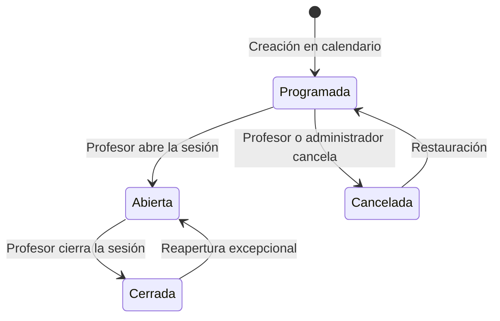

# Session lifecycle

Se propone definir el ciclo de vida de una sesión de clase: estados, transiciones y reglas de negocio. El README describe sesiones en Cursos y calendario y en el Dashboard del profesor, pero no fija cómo nace, se abre, se cierra o se cancela una sesión.

Esta propuesta no sustituye el sistema de estados de asistencia del alumno. La sesión y la asistencia son ciclos distintos: la sesión es el contenedor; cada alumno matriculado tiene un registro de asistencia dentro de ella.

## Estados de la sesión

| Estado | Descripción |
|---|---|
| Programada | Sesión creada en el calendario, con curso, horario, profesor y alumnado. Todavía no admite registro de asistencia. |
| Abierta | Sesión en curso. Se puede registrar entrada, retraso, permanencia y salida. |
| Cerrada | Sesión finalizada. El registro original queda fijado; los cambios posteriores son correcciones auditadas. |
| Cancelada | La clase no se imparte. No cuenta para asistencia, cumplimiento ni alertas predictivas. |

Un aviso de retraso del profesor no es un estado. La sesión sigue `Programada` o `Abierta`; solo cambia el instante desde el que se miden los retrasos de los alumnos.

## Transiciones

| Origen | Destino | Quién | Condición |
|---|---|---|---|
| — | Programada | Administrador de la organización | Alta en Cursos y calendario, con curso, franja horaria, profesor y alumnos matriculados. |
| Programada | Abierta | Profesor asignado | La sesión no está cancelada. Al abrirla, cada alumno matriculado obtiene un registro de asistencia en `Pendiente`. |
| Programada | Cancelada | Profesor asignado o administrador | Debe indicarse un motivo. Se notifica a los alumnos matriculados. |
| Abierta | Cerrada | Profesor asignado | Quien siga en `Pendiente` pasa a `Ausente`. A partir de aquí no se aceptan registros nuevos, solo correcciones. |
| Cerrada | Abierta | Profesor asignado o administrador | Solo en casos excepcionales, con motivo. Queda en auditoría quién, cuándo y por qué. |
| Cancelada | Programada | Administrador de la organización | Restauración con motivo. Vuelve a contar en el calendario. |

No se puede abrir una sesión `Cancelada` sin restaurarla antes a `Programada`. No se puede cancelar una sesión `Abierta`: primero se cierra, o se trata como incidencia. Una sesión `Cerrada` no vuelve a `Programada`.

## Reglas de negocio

- Cada sesión pertenece a un curso y tiene una franja horaria prevista, un profesor asignado y un conjunto de alumnos matriculados.
- Una misma sesión no puede estar en dos estados a la vez.
- El profesor solo puede abrir, cerrar o cancelar las sesiones que tiene asignadas.
- Abrir la sesión no acredita por sí sola la presencia de nadie. Registrar una acción tampoco demuestra permanencia durante toda la clase (sección 11 del README).
- Durante `Abierta` se pueden guardar hora de entrada, comprobaciones de permanencia y hora de salida, cuando el mecanismo de asistencia lo permita.
- Al cerrar, los `Pendiente` pasan a `Ausente` para no marcar ausencias antes de tiempo.
- Después del cierre, el alumno puede solicitar una corrección, pero no modificar el registro original.
- Toda corrección, cancelación, restauración o reapertura conserva auditoría: quién, cuándo y por qué.
- Una sesión `Cancelada` no entra en porcentajes de asistencia ni en predicciones.
- Si el profesor avisa de un retraso, el horario del calendario no cambia; los retrasos de los alumnos se miden desde la hora avisada.
- El aviso anticipado de un alumno (llegará tarde o no asistirá) es informativo: no cambia el estado de la sesión ni sustituye al justificante.

## Permisos

| Perfil | Qué puede hacer con la sesión |
|---|---|
| Administrador de la organización | Crear, editar datos de calendario, cancelar, restaurar y supervisar. |
| Profesor | Abrir, cerrar, cancelar sesiones propias y avisar de un retraso. Reabrir solo con motivo. |
| Alumno | Consultar próximas sesiones, registrar asistencia mientras esté `Abierta` y solicitar correcciones cuando esté `Cerrada`. |
| Administrador de aTempo | No opera el ciclo académico de la sesión; opera el SaaS. |

## Relación con la asistencia

Al abrir la sesión se crean los registros de asistencia. Los estados del alumno (`Pendiente`, `Presente`, `Retraso`, `Ausente`, `Salida anticipada`) viven dentro de una sesión `Abierta` o `Cerrada`. Los justificantes siguen un ciclo propio y no mueven el estado de la sesión.

## Objetivos

- Dejar un criterio único para abrir, cerrar y cancelar clase.
- Evitar registros en sesiones que aún no han empezado o que ya han terminado.
- Separar el ciclo de la sesión del ciclo de asistencia del alumno.
- Dar base a notificaciones (inicio retrasado, clase cancelada, sesiones pendientes) y a evidencias de auditoría.

## Pendiente

Queda pendiente definir:

- Si el cierre es solo manual o también automático al superar la hora de fin.
- El margen para abrir antes de la hora prevista y para reabrir una sesión cerrada.
- Si un profesor puede tener más de una sesión `Abierta` a la vez.
- El mecanismo concreto de asistencia (QR, comprobaciones periódicas, videoconferencia) y cómo se apoya en estos estados.
- Si el cumplimiento se calcula por sesiones, por horas o con ambos criterios.
