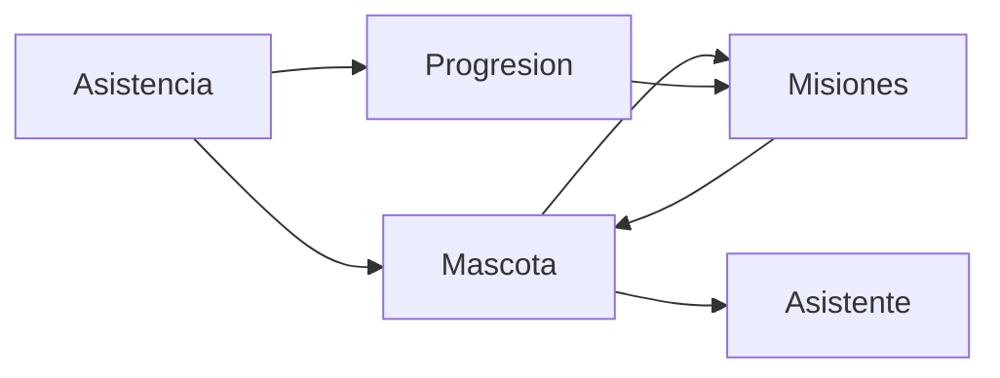

# Tempito

Se propone organizar Tempito en cuatro módulos funcionales. El README (sección 8) define la mascota virtual del alumno y cómo reacciona a la asistencia, pero no descompone apariencia, progresión, misiones ni el papel de asistente de información.

Tempito vive en la pantalla homónima del portal del alumno (sección 5.3). No sustituye al chatbot con RAG ni a la pantalla de Juegos: el chatbot responde preguntas; los juegos son actividades interactivas; Tempito es la mascota, el progreso y los recordatorios cercanos al alumno.

## 1. Mascota virtual

Apariencia, animaciones, personalidad y estados de ánimo.

Tempito es único por alumno. Su aspecto y ánimo reflejan el comportamiento de asistencia reciente, sin convertirse en un castigo visible ante el resto de la clase.

| Elemento | Propuesta |
|---|---|
| Apariencia | Cuerpo base común, con variantes desbloqueables (color, accesorios, fondo). |
| Animaciones | Idle, saludo, celebración al registrar asistencia, descanso si hay racha y gesto de ánimo bajo. |
| Personalidad | Cercana, breve y no punitiva. Nunca avergüenza al alumno ni compara su mascota con la de otros. |
| Estados de ánimo | `Energía alta`, `Estable`, `Baja`, `En recuperación`. |

| Ánimo | Qué lo provoca | Qué se ve |
|---|---|---|
| Energía alta | Asistencia puntual reciente y racha activa. | Animación viva; mensaje de ánimo. |
| Estable | Asistencia irregular o racha corta. | Animación neutra. |
| Baja | Ausencias no justificadas recientes. | Ánimo contenido; invita a retomar, no a culpar. |
| En recuperación | Justificante aprobado o corrección de asistencia. | Vuelve hacia `Estable` o `Energía alta` sin penalizar la ausencia justificada. |

Una ausencia justificada no baja el ánimo. Faltar sin justificar sí puede bajarlo; asistir de nuevo lo recupera.

## 2. Sistema de progresión

Experiencia, niveles, evolución y logros.

La progresión premia la constancia. No sustituye el porcentaje de asistencia ni sirve como sanción académica.

| Concepto | Regla inicial |
|---|---|
| Experiencia | Se gana al cerrar una sesión con presencia (`Presente` o `Retraso`). |
| Niveles | Umbrales fijos de experiencia. Subir de nivel desbloquea apariencia o misiones. |
| Evolución | Cambios de etapa de Tempito ligados a rachas y nivel, no a un único día. |
| Logros | Hitos puntuales: primera asistencia, racha de 5, justificar a tiempo, completar una misión. |
| Rachas | Días o sesiones consecutivas con presencia. Una ausencia justificada no rompe la racha. Una ausencia no justificada sí. |

El retraso da experiencia de presencia, pero menos que la puntualidad. La salida anticipada no anula la experiencia de esa sesión; puede impedir el logro de “sesión completa”.

## 3. Misiones y recompensas

Retos, objetivos y elementos desbloqueables.

Las misiones traducen la asistencia en objetivos claros. Son opcionales: no completarlas no reduce la nota ni el cumplimiento.

| Tipo | Ejemplo | Recompensa |
|---|---|---|
| Reto diario | Registrar asistencia en la próxima sesión. | Experiencia extra. |
| Objetivo semanal | Asistir a todas las sesiones de la semana, o a las no justificadas. | Accesorio o fondo. |
| Desbloqueable | Alcanzar un nivel o una racha. | Variante de apariencia o animación. |

El administrador de la organización puede activar o desactivar misiones por curso. El profesor no las crea en esta versión. Las competiciones entre alumnos (sección 7.4) quedan fuera de Tempito hasta que se definan los juegos.

Una misión nunca exige asistir con una ausencia ya justificada. Si la sesión se cancela, la misión se pospone o se da por cumplida sin penalizar.

## 4. Asistente de información

Mensajes, recordatorios y novedades académicas.

Tempito muestra avisos cortos en su pantalla y, si el alumno lo permite, en notificaciones. No responde con documentación del producto: eso es el chatbot.

| Tipo | Origen | Ejemplo |
|---|---|---|
| Mensaje de mascota | Estado de ánimo y progresión. | “Racha de 4. Mañana hay clase a las 09:00.” |
| Recordatorio | Calendario de sesiones `Programada`. | “Hoy tienes Bases de datos a las 09:00.” |
| Novedad académica | Cancelación, retraso del profesor, justificante resuelto. | “La clase de las 12:00 se ha cancelado.” |

Los recordatorios no cambian el registro de asistencia. Un aviso de “voy a llegar tarde” sigue siendo acción del Dashboard del alumno, no de Tempito.

## Reglas transversales

- Tempito es por alumno, no por curso. El ánimo y la experiencia agregan la asistencia de los cursos matriculados.
- Las ausencias justificadas no penalizan ánimo, racha ni misiones.
- Las sesiones `Cancelada` no cuentan ni a favor ni en contra.
- Tempito no aplica sanciones. El cumplimiento académico se calcula fuera de este sistema (secciones 9 y 11 del README).
- El alumno puede silenciar mensajes de Tempito desde Settings, sin perder progresión.
- El profesor y el administrador ven, como mucho, indicadores agregados de participación; no el estado íntimo de la mascota de cada alumno.

## Permisos

| Perfil | Qué puede hacer |
|---|---|
| Alumno | Ver Tempito, recibir mensajes, completar misiones y personalizar apariencia desbloqueada. |
| Administrador de la organización | Activar o desactivar misiones por curso y consultar participación agregada. |
| Profesor | No opera Tempito. Puede ver alertas de asistencia en su Dashboard, independientes de la mascota. |
| Administrador de aTempo | No opera el ciclo académico de Tempito. |

## Objetivos

- Dar a Tempito una estructura de producto, no solo una idea de mascota.
- Separar apariencia, progresión, misiones y avisos para poder diseñarlos y construirlos por partes.
- Premiar la constancia sin penalizar justificantes ni sustituir el chatbot.
- Conectar la pantalla Tempito con asistencia, calendario y notificaciones ya descritos en el README.

## Pendiente

Queda pendiente definir:

- El diseño visual concreto y las etapas de evolución.
- Los umbrales numéricos de experiencia, niveles y rachas.
- El tratamiento fino de retrasos y salidas anticipadas en la experiencia.
- Si Tempito se muestra también en el Dashboard del alumno o solo en su pantalla.
- La relación exacta con los tipos de juegos, todavía por definir en la sección 13 del README.
