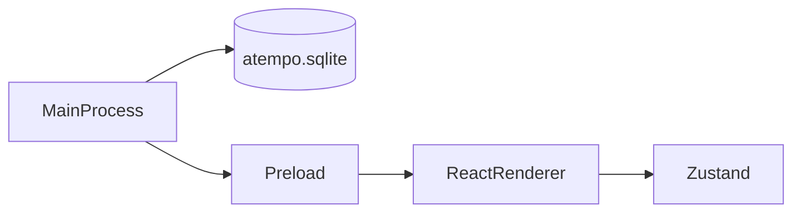

# Arquitectura de aTempo de escritorio

La aplicación tiene tres capas. Cada una vive en su carpeta y no hace el trabajo de las otras.

## Proceso principal

Carpeta: `desktop/src/main/`.

Es Node, dentro de Electron. Abre la ventana y abre SQLite. Si `process.argv` incluye `--sign-up`, carga `#/sign-up`. Si incluye `--dashboard`, carga `#/student/dashboard`. Si incluye `--panel`, carga `#/teacher/panel`. Si no, carga el renderer sin hash.

La base usa la clase `DatabaseSync` de [`node:sqlite`](https://nodejs.org/api/sqlite.html). Electron 44 trae Node 24, y esa versión exporta `DatabaseSync`. El archivo es `atempo.sqlite`, en la carpeta de datos de Electron (`app.getPath('userData')`). Al arrancar se ejecuta `PRAGMA user_version = 1` para comprobar que el archivo abre. El login no lee ni escribe esa base.

## Preload

Carpeta: `desktop/src/preload/`.

Es el puente entre el proceso principal y la pantalla.

## Renderer

Carpeta: `desktop/src/renderer/`.

Es React. Pinta la pantalla de login y guarda el formulario en Zustand (`loginStore.ts`).

Sin hash, o con un hash que no es una ruta conocida, se ve el login. `#/sign-up` muestra el registro. `#/student/dashboard` muestra la maqueta del dashboard del alumno. `#/teacher/panel` muestra el panel del profesor.

El panel del claim y la figura del trimestre se pintan en el renderer y no salen de la base. La figura es la constante `trimesterDays` de `trimesterExample.ts`.

La validación está en `validateLogin.ts`. Comprueba el correo y la contraseña dentro del renderer. Con los dos válidos, `LoginScreen.tsx` pone el hash `#/teacher/panel`.

El panel del profesor está en `desktop/src/renderer/src/panel/`. La lista, las sesiones y la asistencia de ejemplo viven en memoria, en `roster.ts`. El estado de esa pantalla está en `panelStore.ts`. El margen de retraso y los avisos de ejemplo están en `settingsStore.ts`. Todo ese estado vive en Zustand, dentro del renderer, y vuelve a los datos de ejemplo al cerrar la aplicación.

El registro guarda el formulario en Zustand (`registerStore.ts`). La semana del registro es la constante `weekDays` de `weekExample.ts` y no sale de la base.

La validación está en `validateRegister.ts`. Comprueba el nombre, el correo, la contraseña y que la repetida coincida antes de mostrar el alert. No llama a la red y «Inicia sesión» deja el hash de la ruta del login.
