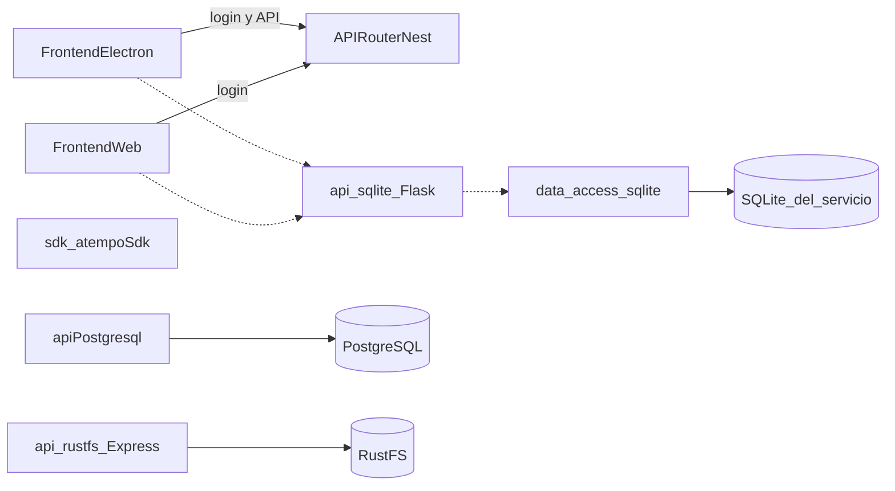
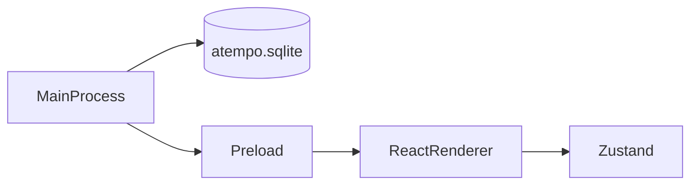

# Arquitectura de aTempo

## API, SDK y persistencia

Carpeta de la SDK: `data-access/`, con `sqlite/` (Python, `atempo-data-access-sqlite`). Clases de error y fábrica `create_error_factory`: `errors/python/` (`atempo-errors`), que `data-access/sqlite/` enlaza como editable con uv y que no conoce aTempo. HTTP de PostgreSQL: `api-postgresql/`. Persistencia SQLite: `api-sqlite/`. Objetos S3-compatible: `api-rustfs/`. `api-router/` sigue en el repositorio.

Los frontends son Electron en `desktop/` y el portal web en `web/`. La web envía sus peticiones al API-router NestJS mediante el proxy de desarrollo Vite `/api`; Electron usa su integración Auth0 desde el proceso principal. El API-router transforma HTTP. Auth0 (`register`, `login`, `refresh`, `logout`, `me`) permanece en `AuthService`. Tras login, register o `me` correctos, el router llama a `afterAuth({ email })` de `atempo-sdk`. `GET /auth/me` sigue `{ email }` con Bearer y `{ email, profile }` con cookie web. `runAfterAuth` traduce `AppError`: `CONFIGURATION` o `PERSISTENCE` → 503 `POSTGRES_API_UNAVAILABLE`; `VALIDATION` → 400. Logout, refresh y Auth0 ko no llaman a la SDK. La **SDK (lógica de negocio)** es el paquete `atempo-sdk` en `sdk/`, hermano de `desktop/` y `api-router/` (`file:../sdk`). Capas: shared (`Result`, `AppError`), dominio, aplicación, infraestructura mock y composición. `afterAuth({ email })` normaliza el correo, comprueba `GET /health` de `api-postgresql` con `fetch` inyectable y busca la persona en el mock; si no hay persona, el resultado es ok y no crea. El router traduce HTTP en módulos Nest `organization/`, `person/` y `course/`: cada controller llama a su service y el service a `atempo-sdk`. CRUD mock: `POST /organizations`, `GET/PATCH /organizations/:organizationId`, `POST/GET /organizations/:organizationId/people`, `GET/PATCH/DELETE /people/:personId`, `POST/GET /organizations/:organizationId/courses`, `GET /organizations/:organizationId/courses/:courseId`, `GET /organizations/:organizationId/courses/:courseId/students`, `POST/GET /organizations/:organizationId/courses/:courseId/people`, `DELETE …/people/:personId`, con Bearer no vacío. No hay `GET /organization/dashboard` ni carpeta `api-router/src/sdk`. La UI del admin y el Resumen de Electron aún no consumen estas rutas. Compose del proyecto `atempo` monta `./api-router` y `./sdk` en el servicio `api-router` y pasa `API_POSTGRESQL_URL`. La SDK hablará con `api-postgresql/` para leer y escribir en PostgreSQL, con `api-sqlite/` para SQLite local y con `api-rustfs/` para objetos en RustFS; hoy solo el cliente de health de `afterAuth` apunta a Postgres. El API-router no habla con la base ni con RustFS. Redis, Postgres y el resto de microservicios del backend quedan fuera del escritorio.

`sdk/` y `data-access/` son dos capas distintas. `sdk/` une el API-router con las `api-xxx`. `data-access/` une las `api-xxx` con la base de datos. `data-access/sqlite/` cubre `session` y `attendance` en SQLite: instantes a ISO UTC, UUID en minúsculas, fichaje coherente con el estado. Su flujo previsto es Frontend → `api-sqlite` → `data-access/sqlite` → SQLite: `api-sqlite` transforma HTTP y `data-access/sqlite` valida los tipos y las reglas de fichaje y abre SQLite. Flask no escribe SQL. `api-sqlite/` aún no lo importa.

`api-router/` expone `GET /health`, `POST /auth/register`, `POST /auth/login`, `POST /auth/refresh`, `POST /auth/logout` y `GET /auth/me`. Electron y web usan esos mismos paths. El login y el alta intercambian credenciales con Auth0 mediante Resource Owner Password Grant (`offline_access`). `/auth/refresh` renueva el access token; `/auth/logout` revoca el refresh token; `/auth/me` valida el Bearer mediante JWKS, emisor, audiencia y caducidad, o la cookie de access en la web. Con origen `ATEMPO_WEB_ORIGIN` (por defecto `http://localhost:5191`) el login fija cookies HttpOnly `atempo_access` y `atempo_refresh` (SameSite=Lax, Path=/, sin Max-Age, Secure en HTTPS) y no devuelve tokens en JSON. Las funciones de cookie viven en `api-router/src/shared/`. El navegador llama a los mismos endpoints con `credentials: 'include'` y usa `/auth/refresh` cuando `/auth/me` responde 401. La web llama al router a través del proxy Vite `/api`; Electron gestiona Auth0 desde su proceso principal. El secreto de cliente solo vive en el router. Con `API_MOCK=true`, el router sirve además, con datos en memoria, los ocho endpoints del contrato API v1 que usa la pestaña Hoy (`src/mock-api/`); requieren un encabezado `Authorization: Bearer` no vacío. Compose lo arranca así y lo publica solo en `127.0.0.1`. La pestaña Hoy llama al router desde main solo con `--api-transport=http`; sin ese flag usa el transporte mock, descrito en «Renderer». `api-postgresql/` expone `GET /health`, los listados `GET /person`, `GET /course`, `GET /organization`, `GET /person-role` y `GET /person-course`, `GET /person/:id` (una fila de `person` por UUID: 200, 404 o 503), `POST /person-course` (una matrícula: 201, 404, 409 o 503) y `DELETE /person-course/:personId/:courseId` (una matrícula: 204, 404 o 503); con `DATABASE_URL` consulta PostgreSQL y sin ella usa un mock de prueba. `api-rustfs/` solo expone `GET /health`, que confirma que el servicio HTTP responde; su conexión S3 se comprueba aparte. `api-sqlite/` solo expone `GET /health`, que ejecuta `SELECT 1`. La activación de invitaciones no llama a estas APIs. Compose publica las cuatro APIs en 3000–3003. Las APIs se conectan por la red interna a PostgreSQL (`postgres:5432`) y RustFS (`rustfs:9000`); los mismos servicios también sirven al almacén operativo. PostgreSQL se publica en el host por `5433` y RustFS por `9000`/`9001`. Los volúmenes compartidos `postgres-data` y `rustfs-data`, junto con `api-sqlite-data`, conservan sus datos.

Hoy `data-access/sqlite/` existe y se prueba con SQLite en memoria. `api-sqlite/` aún no lo importa. `data-access/` no está en Docker Compose.

La documentación interactiva (OpenAPI y Swagger UI) de cada servicio HTTP vive en **`/docs`**. Compose publica `api-router/` en el puerto **3000**, `api-postgresql/` en el **3001**, `api-sqlite/` en el **3002** y `api-rustfs/` en el **3003**.

`sdk/` es el paquete de dominio `atempo-sdk`, hermano de `desktop/`, `api-router/`, `api-postgresql/`, `api-rustfs/` y `api-sqlite/`. El API-router lo consume: `AuthService` llama a `afterAuth` tras login, register y `me`. Los frontends usarán una SDK frontend distinta para llamar al router público; no consumirán directamente la SDK de dominio ni las APIs de persistencia. `api-postgresql/` ya está; `afterAuth` lee su `/health`. `api-rustfs/` espera a que la SDK lo use para objetos en RustFS.

Las flechas discontinuas son el flujo previsto de `data-access/sqlite/`: hoy los frontends no llaman a `api-sqlite/` y ese servicio no importa `data-access/sqlite/`.

## api-sqlite

Carpeta: `api-sqlite/`.

Servicio Flask con modelos Pydantic. El flujo de producto es Frontend → `api-sqlite` → `data-access/sqlite` → SQLite. Este servicio aún no importa el paquete. Solo expone `GET /health`, que ejecuta `SELECT 1`; responde `200` si SQLite funciona y `503` si falla la conexión. Un cuerpo JSON inválido se rechaza antes de consultar la base. Swagger UI está en `/docs` y OpenAPI en `/docs-json`. Compose sirve en el puerto **3002** y ejecuta Flask escuchando en `0.0.0.0`. `SQLITE_DATABASE_URL` apunta a `sqlite:////var/lib/atempo/api-sqlite.sqlite`; el archivo persiste en el volumen `api-sqlite-data`. El entorno virtual Linux está en `api-sqlite-venv`; ambos son independientes de `.venv` y de la base de Electron.

## api-rustfs

Carpeta: `api-rustfs/`.

Servicio Express y TypeScript. La SDK delegará en él la lectura y escritura de objetos en RustFS. Hoy solo expone `GET /health`, que confirma que el servicio HTTP responde (igual que el health de `api-router/`). Swagger UI en **`/docs`** y OpenAPI en **`/docs-json`**, igual que en `api-router/`. Compose lo sirve en el puerto **3003** y conecta al servicio interno `rustfs:9000`. `/health` no comprueba RustFS; el workflow valida S3 aparte. El volumen compartido `rustfs-data` conserva los objetos. RustFS publica el puerto S3 `9000` y la consola `9001` en el host.

## api-postgresql

`api-postgresql/` sirve NestJS en el puerto **3001**. Compose inicia PostgreSQL con el servicio interno `postgres` y espera a su healthcheck antes de arrancar la API. `GET /health` confirma la conexión. `ATEMPO_POSTGRES_PASSWORD` es obligatoria y `POSTGRES_PASSWORD` es su alternativa; ambas se leen desde `.env` ignorado por Git. Las APIs no montan el `.env`; Compose pasa solo las variables necesarias. PostgreSQL 17.12 comparte el volumen `postgres-data` y se publica en el host por `5433`; la API usa `postgres:5432`. Un volumen creado con PostgreSQL 16 requiere copia de seguridad y migración explícita antes de usarse con 17. CI usa un valor efímero.

## Web y administración

El paquete `web/` contiene el portal del alumno y el prototipo de administración bajo `/admin`. Comparten Vite, React, TanStack Router y el tema de `docs/storybook/src/system.css`. En desarrollo Vite proxifica `/api/*` al router del proyecto Compose `atempo`, por defecto en `localhost:3000`. Auth0 es obligatorio para ambos accesos web.

`web/src/auth/webSession.ts` llama a `/api/auth/login`, `/api/auth/me`, `/api/auth/refresh` y `/api/auth/logout` con credenciales de origen incluidas. `sessionStore.ts` conserva solo el perfil y el correo en memoria. Los tokens van en cookies HttpOnly; el navegador no persiste tokens ni contraseñas. Solo `profesor@atempo.test` accede al área admin y solo `ada.lopez@clase.test` al portal del alumno. Auth0 aporta la identidad; el perfil se asigna desde ese correo para esta demo.

`web/src/admin/adminStore.ts` conserva en memoria personas, cursos, matrículas y sesiones de ejemplo. Ventura Rodríguez sustituye a Miguel como administrador y también es profesor. Sus acciones validan entradas, pertenencia a la organización y rol admin antes de escribir. Las invitaciones preparan personas pendientes y no envían correo; el login web avisa de que la activación aún no está disponible. Cada sesión muestra el alumnado de su curso como pendiente. `Mis clases` reutiliza los detalles en modo lectura y filtra los cursos de Ventura; no sustituye al panel de asistencia de Electron.

El CRUD usa `PersonForm`, `CourseForm` y `SessionForm` tanto al crear como al editar. `DeleteConfirmation` muestra el efecto del borrado y exige confirmación. Las actualizaciones conservan IDs; los nuevos IDs no reutilizan los borrados durante ese arranque. Eliminar un alumno limpia sus matrículas; eliminar un curso elimina atómicamente sus sesiones programadas. Un profesor asignado debe reasignarse antes de borrarlo y la sesión admin actual no puede eliminar su propia cuenta. Estas reglas protegen las relaciones del mock; no implementan borrado de históricos de asistencia.

La sesión web se restaura en otra pestaña del mismo origen mientras las cookies HttpOnly sigan válidas; al salir desde alumno o admin, el router revoca el refresh token y borra las cookies. El seed admin y los datos de gestión siguen siendo locales: recargar restablece el seed y descarta cambios de la demo. Vite proxifica `/api/*` al router del puerto 3000 por defecto y elimina el prefijo `/api`.

Este store es un mock del prototipo, no una segunda SDK. El trabajo local de #90 se conserva por separado para una futura SDK frontend que consuma el API-router; la SDK de dominio mantiene las reglas de negocio y expone ya el CRUD mock y el JSON del Resumen por HTTP en el router. La web del admin aún no sustituye `adminStore` por esas rutas. Alcance, referencias y comprobaciones en [admin-prototype.md](admin-prototype.md); pasos para abrirlo en [web/README.md](../web/README.md#probar-administración).

## Almacenes

Carpetas: `postgres/`, `sqlite/`, `rustfs/`, `blockend/`.

Son almacenes y cadena, no una capa del escritorio ni del API-router. Cada una tiene un cliente solo para consultar (Drizzle Studio, Datasette, consola de RustFS, Otterscan). Se instalan y arrancan en el ordenador. Compose de la raíz orquesta los mismos procesos; los perfiles quedan para las herramientas auxiliares y no son requisito para iniciar las APIs. PostgreSQL y RustFS comparten servicio y volumen de datos con sus APIs. Ninguna importa NestJS, Electron ni React. El SQLite de `desktop/src/main/database.ts` (`atempo.sqlite`) es la base local del profesor; `sqlite/` es otro almacén, el operativo de fichaje.

El modelo y los enlaces están en `docs/POSTGRES.md`, `docs/SQLITE.md`, `docs/RUSTFS.md`, `docs/BLOCKEND.md` y `permanent-data.md`.

`api-postgresql/` comprueba la conexión con `GET /health`, ofrece cinco listados (incluidos `GET /organization` y `GET /person-course`), `GET /person/:id`, `POST /person-course` y `DELETE /person-course/:personId/:courseId`. `api-rustfs/` no abre RustFS en el health. El renderer y el API-router no abren estas bases. `afterAuth` en `sdk/` llama al health de Postgres con `fetch` inyectable; el resto de persistencia aún no pasa por la SDK. `data-access/sqlite/` abre SQLite; `api-sqlite/` aún no lo importa.

## aTempo de escritorio

La aplicación de escritorio tiene tres capas. Cada una vive en su carpeta y no hace el trabajo de las otras.

## Proceso principal

Carpeta: `desktop/src/main/`.

Es Node, dentro de Electron. Abre la ventana y abre SQLite. `startupHash()` mira `process.argv` y elige la ruta de arranque. Si hay varios flags, gana el primero de esta lista:

1. `--dashboard` → `/student/dashboard`.
2. `--organization-dashboard` → `/organization/dashboard`.
3. `--invitation=<código>` → `/?invitation=<código>`, como el enlace del correo de invitación. El código solo admite letras, números y guiones.

Sin ninguno de esos flags, carga el renderer sin hash y muestra el login. En desarrollo la ruta va detrás de `#` en `ELECTRON_RENDERER_URL`. En la app empaquetada va en la opción `hash` de `loadFile`. En los dos casos el renderer recibe `#/ruta`.

`--api-fixture=<nombre>` elige los datos del mock de la API y `--api-transport=http` cambia el mock por el transporte HTTP. main los pasa en la dirección como `?apiFixture=<nombre>` y `?apiTransport=http`: en desarrollo, detrás de `ELECTRON_RENDERER_URL`; en la app empaquetada, en la opción `query` de `loadFile`.

El handler `api:request` hace las peticiones del cliente de la API al router de `ATEMPO_API_ROUTER_URL`, con las mismas reglas de URL que el login. `routerRequest.ts` solo deja pasar las rutas del contrato que usa la pestaña Hoy, añade `Authorization: Bearer` con el Access Token guardado y responde en menos de 9,5 segundos, antes de que el renderer deje de esperar. Devuelve el estado y el cuerpo, o que no hubo respuesta. Ante un `401`, pide un token nuevo con el refresh token y repite la petición una vez; si no puede, borra la sesión. Comprueba la ruta tal como la normaliza `URL.parse`, la misma que usará `fetch`, y rechaza los segmentos que, decodificados, son `.` o `..` o llevan `/` o `\`. Si la URL falta o no es segura, responde como si no hubiera respuesta.

Tras el arranque normal, el login valida la cuenta del profesor o del alumno y TanStack Router abre el dashboard de su perfil al pulsar «Entrar». `--organization-dashboard` abre el Resumen de la organización.

Desde `desktop/`, `pnpm dev -- --organization-dashboard` abre directamente el Resumen de la organización sin credenciales.

La base usa la clase `DatabaseSync` de [`node:sqlite`](https://nodejs.org/api/sqlite.html). Electron 44 trae Node 24, y esa versión exporta `DatabaseSync`. El archivo es `atempo.sqlite`, en la carpeta de datos de Electron (`app.getPath('userData')`). Al arrancar se ejecuta `PRAGMA user_version = 1` para comprobar que el archivo abre. Los prototipos de login, invitación, alumno, panel del profesor y Resumen de la organización no leen ni escriben esa base.

## Preload

Carpeta: `desktop/src/preload/`.

Es el puente entre el proceso principal y la pantalla.

## Renderer

Carpeta: `desktop/src/renderer/`.

Es React. Pinta las pantallas de la app (login y activación de invitaciones, dashboards, escaneo e historial del alumno, y el panel del profesor) y guarda su estado en Zustand.

El enrutado es TanStack Router con hash history. `main.tsx` crea el router con `createHashHistory` y `caseSensitive: true`, y pinta `RouterProvider`. Con `caseSensitive: true` las rutas distinguen mayúsculas: `#/Student/Dashboard` no es `/student/dashboard` y muestra el login. Cada pantalla tiene su archivo en `routes/`:

- `routes/index.tsx` → `/`: el login.
- `routes/student/dashboard.tsx` → `/student/dashboard`: el dashboard del alumno (`DashboardScreen`).
- `routes/student/scan.tsx` → `/student/scan`: el registro de asistencia del alumno (`ScanScreen`).
- `routes/student/history.tsx` → `/student/history`: el historial del alumno (`HistoryScreen`).
- `routes/organization/dashboard.tsx` → `/organization/dashboard`: el Resumen de la organización (`OrganizationDashboardScreen`).
- `routes/teacher/panel.tsx` → `/teacher/panel`: el panel del profesor (`PanelScreen`).
- `routes/__root.tsx`: la ruta raíz. Su `notFoundComponent` es el login, así que un hash que no es una ruta conocida también muestra el login.

`UnderConstructionScreen` (`underConstruction/UnderConstructionScreen.tsx`) sigue disponible como componente provisional; ninguna de las rutas actuales lo usa. Recibe la prop `title` y pinta un `h1` con ese título y el texto «En construcción».

El plugin de TanStack Router lee `routes/` y genera `routeTree.gen.ts` al lanzar `electron-vite build` o `pnpm dev`. Ese archivo se sube a git y queda fuera de eslint y de prettier. Al añadir una ruta hay que generar el árbol con uno de esos comandos antes de `pnpm typecheck`, porque `pnpm build` comprueba los tipos antes de construir.

Los paneles del login y de la invitación se pintan en el renderer y no salen de la base. El del login (`ClaimPanel`) lleva «aTempo», el `h1` «Pasar lista ya no es parte de la clase.», el `h2` «Trimestre de ejemplo» y la figura `trimesterDays` de `trimesterExample.ts`. El de la invitación (`InvitePanel`) explica qué hace aTempo sin datos de la persona: «aTempo», el `h2` «Pasar lista ya no es parte de la clase.», «Los alumnos se registran con el QR.», el `h3` «Semana de ejemplo», `weekPresence` («94 % presentes») y la figura `weekDays`, las dos de `login/weekExample.ts`. Los dos pintan su figura con `MarkChart`: una fila de puntos por día y la leyenda debajo.

El login guarda el formulario en Zustand (`loginStore.ts`). Con `ATEMPO_API_ROUTER_URL` configurada, el renderer pide la autenticación al proceso principal de Electron. Este llama al router, cifra el Access Token y el Refresh Token con `safeStorage` y mantiene los bytes cifrados solo en memoria. El renderer no recibe los tokens. El proceso principal usa Bearer para `/auth/me`; si recibe `401`, intenta un refresh y reintenta `/auth/me` una vez. Descarta la sesión al fallar ese reintento, al pulsar «Cerrar sesión» (llama a `POST /auth/logout`) o al cerrar la aplicación. La URL del router debe ser HTTPS, salvo HTTP sobre loopback de desarrollo; en Linux se rechaza el backend `basic_text` de `safeStorage`. Los dos correos de prueba seleccionan paneles de demo; la autorización por recurso se implementará vinculando el correo normalizado del JWT (`GET /auth/me` devuelve solo `{ "email" }`) con `person` en PostgreSQL (`person.id` es el UUID técnico; `person.email` es UNIQUE con índice en minúsculas). Si el correo del formulario y el del token no coinciden tras normalizar, la sesión se descarta y el login falla. Sin URL del router, se usa el modo mock descrito a continuación. `validateLogin.ts` comprueba el formato del correo y los campos obligatorios. Después, `submit()` normaliza el correo con `normalizeEmail` (`trim().toLowerCase()`) y busca primero una cuenta de profesor en `useTeacherAccountsStore` (`teacherAccounts.ts`): la pública de `teacherDemoAccount.ts`, `profesor@atempo.test` / `Profesor123!`, o una invitación activada durante ese arranque. La contraseña debe coincidir exactamente. Si coincide, abre la sesión con `startTeacherSession(correo, nombre)`, vacía el formulario (correo y contraseña) y devuelve `true`. El correo y el nombre siguen guardados en la sesión. Con Auth0, la cuenta de ejemplo del profesor abre la sesión con su nombre de `teacherDemoAccount.ts`.

No hay registro abierto: la organización invita. El correo de invitación lleva un enlace al login con `?invitation=<código>`; `routes/index.tsx` valida ese parámetro de búsqueda y `LoginScreen` lo lee con `useSearch`. Sin parámetro, `LoginScreen` pinta `ClaimPanel` y `LoginForm`, sin aviso. Con el código de una invitación pendiente (`invitations.ts`), `LoginScreen` pinta `InvitePanel` y `ActivateForm` (`activateStore.ts`), en la misma disposición que `ClaimPanel` y `LoginForm`. `ActivateForm` lleva el `h1` «Hola, `<nombre de pila>`», el texto «Te han invitado a aTempo. Elige una contraseña para entrar con `<correo>`.» y el campo «Contraseña», con la pista «Al menos 8 caracteres.» debajo. Si hay error, el error sustituye a la pista. `validateActivation.ts` exige 8 caracteres o más. «Entrar» comprueba antes si hay router: con Auth0 la cuenta se crea en el servidor, así que el formulario muestra «Las invitaciones todavía no están disponibles con tu organización. Entra con tu cuenta.» y no crea nada. Sin router, crea la cuenta de profesor o de alumno, abre la sesión, vacía el formulario y navega al dashboard de su perfil. Una invitación está usada si ya hay una cuenta con su correo (`isInvitationUsed`). Con un código usado o desconocido, `LoginScreen` pinta también `ClaimPanel` y `LoginForm`, y la tarjeta lleva encima de «Correo» un aviso con `role="status"`. Las casillas de `Field`, en el login y en la invitación, son `input w-full`: el sistema les da fondo `base-100` y un anillo de 1 px, así se ven sobre la tarjeta en los dos temas.

Para otros correos, busca una cuenta en `useStudentAccountsStore`: la demo `ada.lopez@clase.test` / `clase-2026` o un alumno que activó su invitación durante ese arranque, como Bruno Sanz. Si la contraseña coincide, abre su sesión con `startStudentSession(account.email)`, vacía el formulario y devuelve `true`. Cualquier fallo (correo desconocido o contraseña incorrecta, de profesor o de alumno) muestra el mismo alert de error, para no revelar qué correos tienen cuenta. Los fallos devuelven `false`, sin crear sesión, navegar ni repetir las credenciales en el aviso. En modo mock, el login no llama a la red. Al salir de la pantalla, `LoginForm` llama a `reset()` y el formulario se vacía, también tras un intento fallido.

La sesión está en `session/sessionStore.ts`. Define los tipos `Profile` (`'student'`, `'teacher'` u `'organization'`) y `DashboardPath`, la función `dashboardPathForProfile(profile)` y el store de Zustand `useSessionStore`, con `profile`, `email` y `name` a `null` al arrancar. `startStudentSession(email)` pone el perfil de alumno y su correo; la usan el login y la activación de una invitación de alumno. `startTeacherSession(email, name)` pone el perfil de profesor, su correo y su nombre, que el panel enseña y que firma las correcciones. `startSession(profile, email)` la usa el arranque con Auth0 para el alumno recuperado con `/auth/me`. `endSession()` vacía los tres y pide al proceso principal que borre el token de Auth0: «Salir», en el menú de la cuenta del panel y en el inicio del alumno, la llama y vuelve al login. `clearSession()` vacía la sesión sin llamar al puente, cuando Auth0 ya la dio por caducada. Las cuentas mock viven en memoria: al reiniciar la app se pierden las cuentas activadas con una invitación y se restablecen los datos de ejemplo. En modo mock, la sesión se vacía al recargar el renderer. En modo Auth0, el proceso principal conserva el token cifrado mientras vive y el renderer puede recuperar la sesión con `/auth/me` tras recargar; al cerrar la aplicación se exige un login nuevo.

`dashboardPathForProfile` da la ruta de cada perfil:

- `student` → `/student/dashboard`.
- `teacher` → `/teacher/panel`.
- `organization` → `/organization/dashboard`.

Tras un envío correcto, el login lee el perfil actualizado con `useSessionStore.getState()` y navega con `navigate({ to: dashboardPathForProfile(profile) })`. El profesor abre Hoy en `/teacher/panel` y el alumno, `/student/dashboard`. Un envío fallido conserva la ruta del login.

El panel del profesor está en `desktop/src/renderer/src/panel/`. La pestaña Hoy lee y guarda la clase del día a través del cliente de la API. Las demás pestañas siguen con la lista, las sesiones y la asistencia de ejemplo de `roster.ts`. El estado de la pantalla está en `panelStore.ts` y los avisos de ejemplo, en `settingsStore.ts`. Todo vive en Zustand, dentro del renderer, y vuelve a los datos de ejemplo al cerrar la aplicación.

El cliente de la API está en `desktop/src/renderer/src/api/`. `client.ts` define `ApiClient`, con una función por endpoint del contrato API v1 de la issue #90, y elige el transporte. Por defecto es el mock, `mockTransport.ts`: guarda el estado en memoria y aplica las reglas del contrato. Una sesión solo se abre si está programada y es su día; al cerrarla, los pendientes pasan a ausentes; el motivo de una corrección es opcional y, sin él, el registro guarda `reason: null`. Sus datos salen de `fixtures.ts`, que reutiliza los de `roster.ts`. `panel/apiValues.ts` traduce los valores del contrato, en inglés, a los de la pantalla. Con `--api-transport=http`, el transporte es `httpTransport.ts`: arma la ruta del contrato, la envía a main por `window.api.router.request` y convierte el cuerpo de error del contrato en `ApiError`. Un error sin `code` toma el de su estado (`400`, `401`, `403`, `429` o `503`) y, si no lo hay, `INTERNAL_ERROR`. Sin respuesta, es `NETWORK_ERROR` o, tras 10 segundos, `NETWORK_TIMEOUT`. El renderer no hace peticiones de red ni ve el token. Cancelar una petición la libera en el renderer, pero main no la aborta. El mock y las pruebas visuales siguen usando el transporte mock.

La pestaña pide las sesiones del día de hoy en el ordenador (`localDay`), y el mock crea la clase de ejemplo para ese día. Las horas de una corrección se escriben con la fecha y la zona horaria de la sesión (`atSessionTime`). «Simular llegada» y «Volver a abrir» son controles de la demo (`DemoControls`), no del contrato. Con el transporte HTTP no hay `DemoControls` y los dos botones quedan desactivados. El margen de tarde sale de la sesión (`lateMinutes`). El de Ajustes está desactivado y avisa de que no se aplica todavía. Una sesión `cancelled` se muestra como cancelada y no deja corregir.

Antes de abrir, la lista sale de los alumnos del curso (`listCourseStudents`). Con la lista abierta o cerrada, sale de los registros de asistencia (`listAttendances`).

Con la lista abierta, el store pide el código a `getCheckInCode`. `SessionQr` dibuja con `uqr` un QR real con el enlace `checkInUrlFor(studentSiteUrl, código)` = `<sitio del alumno>/student/check-in?code=ATEMPO-CLASE-1109-<código>`, y debajo el código de 6 cifras y la cuenta atrás hasta `expiresAt`. `panel/studentSite.ts` toma el sitio de `VITE_STUDENT_SITE_URL` (tipo en `env.d.ts`); sin ella, o vacía, es `http://localhost:5191`. El QR va siempre oscuro sobre claro (`.class-qr` en `app.css`, con `light-dark()`) para leerse en los dos temas. Al caducar el código, pide uno nuevo. Si la petición falla, lo vuelve a pedir a los 5 segundos; sin código, muestra «Pidiendo el código…». No se renueva mientras se abre o se cierra la lista. El mock da el código de `classCode.ts`, la misma regla que comprueba el sitio del alumno: periodos de 30 segundos alineados con el reloj (`floor(Date.now() / 30000)`) y FNV-1a de `ATEMPO-CLASE-1109:<periodo>` módulo 1000000 con 6 cifras; `expiresAt` es el final del periodo. El sitio del alumno acepta el periodo anterior, el actual y el siguiente. Un intervalo actualiza la cuenta; `visibilitychange` y `focus` la recuperan sin reproducir ticks perdidos. Al cerrar la lista, salir de Hoy o abrir una ficha, el componente se desmonta y limpia el intervalo y las escuchas.

«Simular llegada» hace llegar al siguiente alumno pendiente, en el orden de la lista, a su hora de `todayEntry`. El mock aplica las reglas de `POST /check-ins`: Tarde si la hora pasa del inicio más `lateMinutes`, con `arrivalStatus` de `api/attendanceRules.ts`, que usa `statusForArrival`, la misma regla que el alumno. Una llegada repetida no cambia el registro. Mientras la última escritura del registro sea su propia llegada (`checkedInByStudent`), el alumno no puede pasar a Ausente.

Con la lista abierta o cerrada, el profesor corrige la marca o la hora de entrada de un alumno. Cada corrección abre `CorrectionReasonDialog`, un diálogo provisional con el motivo opcional («Motivo · recomendado»), y se envía con `correctAttendance`; sin motivo, la petición va sin `reason`. Elegir la marca que ya tiene no abre el diálogo. Cada cambio de marca guardado entra en `changes` (`MarkChange`: de qué a qué, motivo, quién y cuándo), igual que las correcciones de Sesiones, y se lee al pasar por encima del estado. Mientras se guarda una corrección, no se puede cancelar ni empezar otra. Si guardarla falla por la red, el servidor o la validación, el diálogo sigue abierto con el motivo escrito y muestra el error; tras un `404` o un `409` se cierra y la pestaña vuelve a leer la clase. Corregir la hora vuelve a calcular Presente o Tarde con la misma regla. Solo un alumno Presente o Tarde tiene hora; una marca puesta a mano llega sin hora.

Los errores siguen la sección «Errores» del contrato. `ApiError` lleva `statusCode`, `error`, `code`, `message` y, en validación, `details`. Un error de conexión tiene `statusCode` 0. `withRequestRules`, en `client.ts`, envuelve cualquier transporte: corta y aborta una petición sin respuesta a los 10 segundos (`NETWORK_TIMEOUT`), acepta una señal para cancelarla (`REQUEST_CANCELLED`) y repite una vez una lectura que falla por la conexión. Una escritura nunca se repite.

Si una petición falla, la pestaña enseña el mensaje que corresponde a su `code` y la marca no cambia; una cancelación no enseña nada. Tras un `409`, un `404` o un error de conexión, vuelve a leer la clase para enseñar cómo está de verdad. Un `401` vacía la pestaña y vuelve al login. Si falla la primera lectura, la pestaña ofrece «Reintentar».

`--api-fixture` elige la fixture del mock: `success`, `empty`, `denied`, `unauthenticated`, `network`, `timeout`, `server-error`, `conflict`, `expired-code` o `code-unavailable`. No se aplica con `--api-transport=http`.

Con la lista cerrada (Hoy después de «Cerrar lista» y todas las sesiones pasadas), el menú de estado sigue activo, pero elegir otro estado abre «Cambiar a …» (`CorrectionDialog`, en `markCorrection.tsx`), con el motivo opcional. `correctSessionMark` solo acepta Presente, Tarde o Ausente, distinto del actual; una llegada aceptada por el lector tampoco pasa a Ausente después de cerrar. Cada cambio se añade a `changes` con la sesión, el alumno, el estado anterior y el nuevo, el motivo (vacío si no hay), el nombre del profesor de la sesión y la hora (`principles.md`, sección 11). Al pasar el ratón por encima del estado, o al llevarle el foco con el teclado, la nota de `MarkControl` enseña esos cambios, del más reciente al más antiguo, y el justificante si es una ausencia. La nota empieza en el borde de abajo de la zona del estado, sin hueco: el espacio de arriba es parte de la nota. Se cierra 300 ms después de que el ratón o el foco salgan del estado y de la nota, así que el ratón pasa del estado a la nota sin cerrarla. Los lectores de pantalla leen cada cambio (de qué estado a cuál, el motivo y quién) en un `sr-only`. Un cambio sin motivo no enseña esa línea. Un Ausente corregido en una sesión pasada no enseña hora de entrada. Los cambios viven en memoria, como el resto del panel.

Las pantallas de detalle del panel (una sesión, la ficha de un alumno) tienen arriba un botón que vuelve a la anterior y dice a cuál: «Sesiones», «Hoy», «Estadísticas» o la fecha de la sesión (`navigation/BackButton.tsx`). Las secciones de la barra lateral no lo tienen.

Abajo en la barra lateral, `AccountMenu` (`panel/AccountMenu.tsx`) enseña el avatar de 32 px, el nombre del profesor y «Profesor». Al pulsar esa fila se abre hacia arriba un menú con «Ajustes», «Cambiar contraseña» (sin Auth0) y «Cerrar sesión». Ajustes no está en la navegación de secciones: se abre desde este menú y, como las secciones, no tiene botón de volver. Es un `details` `dropdown dropdown-top`: se cierra al pulsar otra vez, al pulsar fuera o con Escape, que devuelve el foco al nombre. `docs/storybook/src/system.css` oculta el `.dropdown-content` de un `details.dropdown` sin `[open]` y quita el marcador del `summary`.

El menú de estado se puede usar con teclado: al abrirlo, el foco pasa a la primera opción; Tab recorre las opciones; al elegir una o pulsar Escape, el foco vuelve al botón de la fila. Se cierra si el foco o un clic van a otro control, al desplazar y al cambiar el tamaño de la ventana.

`demoArrivals` conserva únicamente los índices con llegada simulada aceptada. Para esas filas de Hoy, `MarkControl` omite Ausente y `setMark` rechaza Ausente/Pendiente; siguen permitidas las correcciones de Presente/Tarde y hora. Las demás filas y los controles históricos mantienen sus opciones. Cerrar y volver a abrir conservan marcas, horas y evidencia de llegada; `openSession` inicia una sesión nueva y vacía los tres registros. Cancelar el cierre conserva el periodo abierto.

El Resumen de la organización vive en `organization/`. `OrganizationDashboardScreen.tsx` pinta los datos ficticios tipados de `organizationExample.ts`. No calcula asistencia ni llama a servicios.

La única métrica global es el número de estudiantes distintos con al menos 3 ausencias no justificadas en las últimas 5 sesiones o al menos 4 retrasos en las últimas 6. Quien cumple los dos patrones cuenta una sola vez. Cuando hay justificantes o correcciones pendientes, un único aviso lo explica y los cursos y estudiantes afectados lo indican. Las áreas futuras de la navegación son solo texto.

Las cuentas de alumno viven en `student/studentAccounts.ts`, en el store de Zustand `useStudentAccountsStore`. Al arrancar tiene la cuenta de ejemplo de `student/studentExample.ts`, Ada López, con su historial de clases. `findByEmail` y `recordEntry` comparan el correo sin espacios a los lados y sin distinguir mayúsculas (`normalizeEmail`). `addAccount` crea una cuenta sin clases. `recordEntry` pone una clase la primera del historial y no repite una clase que ya está. Nada de esto sale de la base.

`useCurrentStudent()`, en `student/studentAccounts.ts`, da la cuenta de la sesión abierta: busca el correo de `useSessionStore` entre las cuentas con `normalizeEmail`. Sin sesión da la cuenta de ejemplo del propio store, con su historial actualizado. Por eso `#/student/dashboard`, `#/student/scan` y `#/student/history` sin sesión muestran a Ada López. Si la sesión no es de alumno (por ejemplo, la del profesor) o su correo no es de ninguna cuenta, da `null` y esas pantallas muestran `NoStudentSession` («No hay una sesión de alumno»): nunca enseñan ni guardan datos de otra persona.

`student/studentExample.ts` también tiene la clase de hoy (Mié 11 nov, 09:00), el margen de tarde (`lateMinutes`, 10 minutos) y las lecturas de ejemplo del QR. `student/attendanceStatus.ts` define el tipo `AttendanceStatus` (`'presente'`, `'tarde'` o `'ausente'`), sus textos en `statusLabel` y `statusForArrival(arrival, start, lateMinutes)`, que da `'presente'` si la llegada es como mucho `start` más el margen y `'tarde'` si es después.

Las pantallas del alumno viven en `student/` y usan `useCurrentStudent()`:

- `student/dashboard/DashboardScreen.tsx` saluda con «Bienvenido» y el nombre de la cuenta. «Salir» cierra la sesión y vuelve al login. «Registrar asistencia» navega a `/student/scan` y «Resumen de asistencia» a `/student/history`, con `navigate()` de `useNavigate()`. «Próxima clase» y «Avisar de retrasos o ausencias» no hacen nada.
- `student/scan/ScanScreen.tsx` muestra la clase de hoy y el botón «Escanear», que abre el lector en un `dialog` de daisyUI. El lector no usa la cámara: ofrece las lecturas de ejemplo y «Cerrar»; «Cerrar» o el fondo lo cierran sin cambiar nada. Al elegir una lectura se cierra el lector y la pantalla muestra el resultado en un `alert` con `role="status"`:
  - Código de otra clase: «Este código no es de esta clase.» El historial no cambia.
  - La clase de hoy ya está en el historial: «Ya registraste tu entrada a las HH:MM.», con la hora de la primera lectura.
  - Si no: calcula el estado con `statusForArrival`, guarda la clase con `recordEntry` y muestra el estado y la hora, por ejemplo «Presente · 08:58».
- `student/history/HistoryScreen.tsx` lista el historial de la cuenta en su orden, de la más reciente a la más antigua. Cada fila dice la fecha, la hora de entrada («—» si es una ausencia) y el estado con su punto de color, que toma de `markClass` de `login/trimesterExample.ts`. Sin clases dice «Todavía no tienes clases.»

Escaneo e historial tienen un enlace «Volver» a `/student/dashboard`.

## Pruebas de escritorio

Las suites Playwright lanzan el build real a través de `desktop/tests/helpers/electron.ts`. El arnés de tests comprueba la fuente y el build antes del arranque e instala guardas nativas antes de cargar el main. En macOS mantiene las ventanas ocultas, bloquea su activación y vigila el primer plano y el cierre de los procesos propios, con auditoría persistente. Aborta si no puede observar o mantener esas condiciones; no admite un arranque visible. El smoke obligatorio y los comandos están en [README.md](../README.md#escritorio).

El arnés vive exclusivamente en `desktop/tests/`: el arranque normal y las capas de la aplicación conservan su comportamiento.

## Entorno de instalación

Docker instala lo que el proyecto necesita con versiones comunes para el equipo: Node 24.22.3, pnpm 10.33.0 y APM 0.35.0. La imagen también instala Python 3.13 para ejecutar `api-sqlite/`; APM conserva además su propio Python integrado. La instalación se define en `Dockerfile`, `docker-compose.yml` y `docker/setup.sh`.

- La imagen parte de `node:24.22.3-trixie`. El binario oficial de APM se comprueba con su SHA-256. Python 3.13 y su soporte de venv se instalan desde un snapshot Debian fijado.
- `apt-snapshot-install` desactiva la caducidad (`Valid-Until`) solo en su `apt-get update` del snapshot; la firma se sigue comprobando. Los `Release` de `trixie-updates` y `trixie-security` caducan unos siete días después de publicarse: sin eso, la construcción fallaría pocos días después de fijar la fecha, o el mismo día con una fecha antigua.
- Las correcciones de seguridad de Debian solo llegan al subir `DEBIAN_SNAPSHOT`. El workflow `debian-snapshot.yml` lee el `Dockerfile` de `staging` el día 1 de cada mes y abre una issue `chore` si la fecha tiene más de 30 días.
- `setup` ejecuta `apm install`, instala con lockfiles los paquetes Node de escritorio, Storybook, `sdk/`, las APIs, `blockend/` y `postgres/` (volumen `sdk-node-modules` para `sdk/`), y prepara el venv de `api-sqlite/`.
- Las skills y agentes de delivery-workflow quedan en la carpeta del proyecto para Cursor, Codex y Claude Code.
- Los `node_modules` y el venv Python viven en volúmenes Docker separados por paquete; pnpm comparte su caché. Compose los crea vacíos y de root. `docker/entrypoint.sh` los deja del usuario `node` en cada arranque y el comando sigue con ese usuario. Las dependencias Linux no se mezclan con las del ordenador.
- Compose sirve Storybook en 6006 y las APIs en 3000–3003. El servicio `api-router` monta `./api-router` y `./sdk`. Las APIs alcanzan PostgreSQL y RustFS mediante sus nombres de servicio, y esos almacenes también conservan los puertos host de desarrollo. Los datos de `api-sqlite`, PostgreSQL y RustFS viven en volúmenes independientes.
- Compose también ofrece perfiles para PostgreSQL operativo, SQLite operativo, RustFS de justificantes y blockend, documentados en el README. `desktop` ejecuta las comprobaciones de su paquete y `blockend` las de Hardhat.
- El workflow `.github/workflows/workstation-test.yml` valida la instalación limpia y repetida, las APIs y sus datos persistentes en Ubuntu.
- `desktop-gui`, opcional, usa la etapa gráfica del Dockerfile, con librerías fijadas desde un snapshot Debian. Abre Electron en el servidor X11 del ordenador y se activa con el perfil `gui`.
- Los hooks de `.githooks/` ejecutan `setup` tras pull, cambio de rama o rebase cuando cambian los manifiestos, lockfiles, scripts de instalación o Dockerfile. Reconstruyen la imagen si hace falta; si Docker no está en marcha, avisan y git continúa.

Docker es el instalador, no el entorno de trabajo. Cursor y Codex se usan sobre todo desde sus apps de escritorio, y esas apps trabajan sobre la carpeta del ordenador: el agente lanza allí sus comandos, no dentro de un contenedor. Por eso cada ordenador sigue necesitando `git`, `gh`, Node y bash para el flujo de delivery-workflow, y la ventana de Electron se abre en el ordenador. `desktop-gui` puede abrirla desde Docker en la pantalla del ordenador, a través de X11, pero es opcional y experimental.

Se descartó trabajar dentro de un Dev Container:

|                                | Docker como instalador                                  | Dev Container                                          |
| ------------------------------ | ------------------------------------------------------- | ------------------------------------------------------ |
| App de escritorio de Codex     | Funciona                                                | No abre proyectos dentro de un contenedor              |
| App de escritorio de Cursor    | Funciona                                                | Con su extensión de Dev Containers, que falla a menudo |
| Ventana de Electron            | En el ordenador, o desde Docker con `desktop-gui` y X11 | Sin pantalla dentro del contenedor                     |
| Lo que necesita cada ordenador | Docker, git, `gh`, Node y bash                          | Docker y git                                           |
| Windows                        | WSL o Git Bash para el flujo                            | Resuelto: el contenedor es Linux                       |

`.devcontainer/devcontainer.json` usa la misma imagen para quien pueda abrir un Dev Container. Es opcional.
