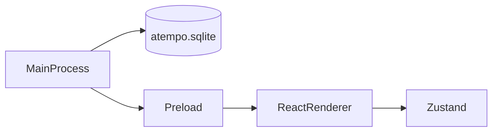

# Arquitectura de aTempo de escritorio

La aplicación tiene tres capas. Cada una vive en su carpeta y no hace el trabajo de las otras.

El proceso principal carga el renderer con la query `screen=sign up` solo si `ATEMPO_SCREEN` es `sign up`. El registro no llama al preload. El puente que ya había sigue ahí: `window.electron` (`electronAPI`, con `ipcRenderer`, `webFrame`, `webUtils` y `process`) y `window.api`. El renderer pinta el login o el registro. La semana del registro es la constante `weekDays` y no sale de la base.

## Proceso principal

Carpeta: `desktop/src/main/`.

Es Node, dentro de Electron. Abre la ventana y abre SQLite.

El proceso principal carga el renderer con la query `screen=sign up` solo si `ATEMPO_SCREEN` es `sign up`. En desarrollo esa query se añade a `loadURL`. Si no hay URL de desarrollo, `loadFile` la recibe en `query`. Sin la variable, o con otro valor, no hay query.

La base usa la clase `DatabaseSync` de [`node:sqlite`](https://nodejs.org/api/sqlite.html). Electron 44 trae Node 24, y esa versión exporta `DatabaseSync`. El archivo es `atempo.sqlite`, en la carpeta de datos de Electron (`app.getPath('userData')`). Al arrancar se ejecuta `PRAGMA user_version = 1` para comprobar que el archivo abre. El login y el registro no leen ni escriben esa base.

## Preload

Carpeta: `desktop/src/preload/`.

Es el puente de la plantilla de Electron, anterior al registro. Expone `window.electron` (`electronAPI`, con `ipcRenderer`, `webFrame`, `webUtils` y `process`) y `window.api`. Ese puente se queda. El registro no lo llama. Ni el login ni el registro leen datos del proceso principal.

## Renderer

Carpeta: `desktop/src/renderer/`.

Es React. El renderer pinta el login o el registro. `screenFromSearch` lee `window.location.search`. Solo el valor `sign up` abre el registro. Cualquier otro valor abre el login. En `App.tsx` esas pantallas son los strings `sign in` y `sign up`.

El login guarda el formulario en Zustand (`loginStore.ts`). El panel del claim y la figura del trimestre se pintan en el renderer y no salen de la base. La figura es la constante `trimesterDays` de `trimesterExample.ts`. La validación está en `validateLogin.ts`. Comprueba el correo y la contraseña antes de mostrar el alert. No llama a la red y no abre otra pantalla.

El registro guarda el formulario en Zustand (`registerStore.ts`). La semana del registro es la constante `weekDays` y no sale de la base. Vive en `weekExample.ts`, junto al texto literal `weekPresence` («94% presentes»). La validación está en `validateRegister.ts`. Comprueba el nombre, el correo, la contraseña y que la contraseña repetida coincida antes de mostrar el alert. No llama a la red, no abre otra pantalla y no escribe en la base.
