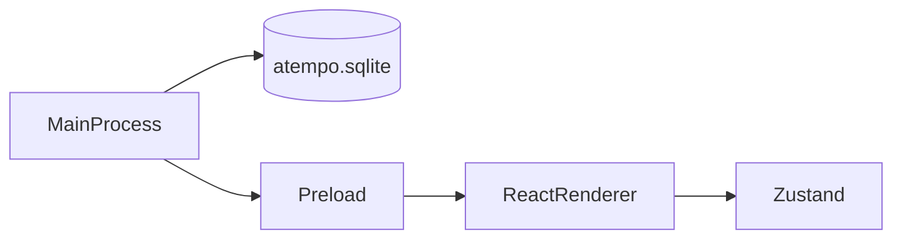

# Arquitectura de aTempo de escritorio

La aplicación tiene tres capas. Cada una vive en su carpeta y no hace el trabajo de las otras.

## Proceso principal

Carpeta: `desktop/src/main/`.

Es Node, dentro de Electron. Abre la ventana y abre SQLite.

La base usa la clase `DatabaseSync` de [`node:sqlite`](https://nodejs.org/api/sqlite.html). Electron 44 trae Node 24, y esa versión exporta `DatabaseSync`. El archivo es `atempo.sqlite`, en la carpeta de datos de Electron (`app.getPath('userData')`). Al arrancar se ejecuta `PRAGMA user_version = 1` para comprobar que el archivo abre. El login y el Dashboard de la organización no leen ni escriben esa base.

## Preload

Carpeta: `desktop/src/preload/`.

Es el puente entre el proceso principal y la pantalla. El login y el Dashboard de la organización no necesitan datos del proceso principal, así que este puente no expone ninguna función.

## Renderer

Carpeta: `desktop/src/renderer/`.

Es React. Pinta la pantalla de login y guarda el formulario en Zustand (`loginStore.ts`). `App.tsx` muestra `OrganizationDashboardScreen` cuando el formulario tiene un envío válido. Es una transición del prototipo, sin autenticación real, rutas ni persistencia de sesión.

El panel del claim y la figura del trimestre se pintan en el renderer y no salen de la base. La figura es la constante `trimesterDays` de `trimesterExample.ts`.

La validación está en `validateLogin.ts`. Comprueba la forma del correo y que la contraseña no esté vacía antes de aceptar el envío. No llama a la red.

El Dashboard de la organización vive en `organization/`. Reutiliza el escritorio para el prototipo visual autorizado en la issue #29; no incorpora funciones de administración. `OrganizationDashboardScreen.tsx` presenta el modelo tipado de `organizationExample.ts`, con ejemplos normal/provisional, vacío y datos incompletos. Los ejemplos tienen cifras y patrones preparados; no hay un motor de cálculo de asistencia ni consultas a servicios.

La única métrica global es el número de estudiantes distintos con al menos 3 ausencias no justificadas en las últimas 5 sesiones o al menos 4 retrasos en las últimas 6. El ejemplo incluye un estudiante con ambos patrones que cuenta una sola vez. La pantalla muestra porcentajes solo en la tabla por curso, y no incluye salidas anticipadas. Los avisos son informativos y no aplican sanciones.

La navegación hacia las demás áreas es texto marcado como Próximamente. Los datos, los avisos y el perfil son ficticios. La pantalla acepta un modelo de presentación para comprobar estados de borde sin añadir controles al producto, y utiliza los dos temas existentes.
