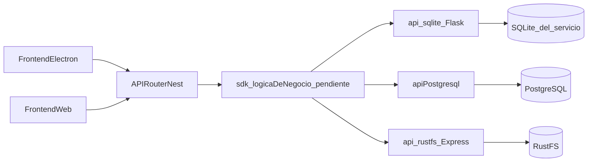
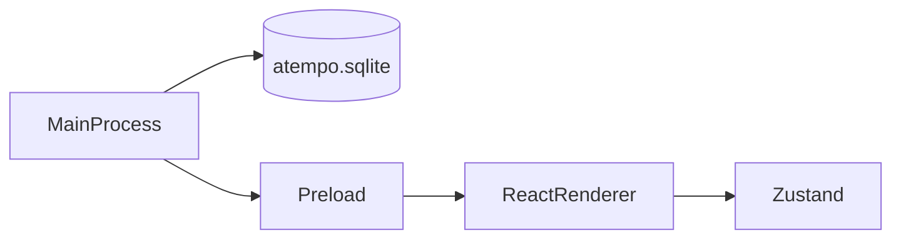

# Arquitectura de aTempo

## API-router, SDK y persistencia

Carpeta del router: `api-router/`. Persistencia relacional: `api-postgresql/` y `api-sqlite/`. Objetos en almacén S3-compatible: `api-rustfs/`.

Los frontends (Electron en `desktop/` y el futuro portal web) hablarán REST con el API-router, un servicio NestJS. El API-router transforma HTTP y delegará en la **SDK (lógica de negocio)**. Esa SDK vivirá en `sdk/`, al mismo nivel que `desktop/` y `api-router/`; la carpeta aún no existe. La SDK hablará con `api-postgresql/` para leer y escribir en PostgreSQL, con `api-sqlite/` para SQLite local y con `api-rustfs/` para objetos en RustFS. Este flujo está previsto: la SDK todavía no existe y los servicios aún no están conectados entre sí. El API-router no habla con la base ni con RustFS. Redis, Postgres y el resto de microservicios del backend quedan fuera del escritorio.

Hoy `api-router/` solo expone `GET /health`. `api-postgresql/` expone `GET /health` y `GET /course` (listado SQL de `course` con `DATABASE_URL`; sin URL, mock local con datos de prueba). `api-rustfs/` solo expone `GET /health`, que confirma que el servicio HTTP responde (igual que `api-router/`). `api-sqlite/` solo expone `GET /health`, que ejecuta `SELECT 1` para comprobar SQLite. El renderer todavía no llama a ninguna de estas APIs: la pestaña Hoy del panel del profesor usa un cliente con transporte mock, descrito en «Renderer». PostgreSQL, `api-postgresql/`, RustFS, `api-rustfs/` y `api-sqlite/` no están en Docker Compose.

La documentación interactiva (OpenAPI y Swagger UI) de cada servicio vive en **`/docs`** con el servicio en marcha; sirve para probar endpoints a mano, no implementa lógica de negocio. `api-postgresql/` escucha en el puerto **3001**, `api-sqlite/` en el **3002** y `api-rustfs/` en el **3003** (`PORT` en cada uno).

`sdk/` es un paquete hermano de `desktop/`, `api-router/`, `api-postgresql/`, `api-rustfs/` y `api-sqlite/`. El API-router y los frontends la consumirán cuando exista. `api-postgresql/` ya está y espera a esa SDK. `api-rustfs/` también: la SDK lo usará para objetos en RustFS.

## api-sqlite

Carpeta: `api-sqlite/`.

Servicio Flask con modelos Pydantic y consultas mediante SQLAlchemy Core. La SDK delegará aquí la persistencia local. Hoy solo expone `GET /health`, que ejecuta `SELECT 1`; responde `200` si SQLite funciona y `503` si falla la conexión. Un cuerpo JSON inválido se rechaza antes de consultar la base. Swagger UI está en `/docs` y OpenAPI en `/docs-json`. Escucha en el puerto **3002** (`PORT`). `SQLITE_DATABASE_URL` configura la base, por defecto `sqlite:///./api-sqlite.sqlite`, independiente de la base de Electron. No está en Docker Compose.

## api-rustfs

Carpeta: `api-rustfs/`.

Servicio Express y TypeScript. La SDK delegará en él la lectura y escritura de objetos en RustFS. Hoy solo expone `GET /health`, que confirma que el servicio HTTP responde (igual que `api-router/`). Swagger UI en **`/docs`** y OpenAPI en **`/docs-json`**, igual que en `api-router/`. Por defecto escucha en el puerto **3003** (`PORT`). No está en Docker Compose en este paso.

## Almacenes

Carpetas: `postgres/`, `sqlite/`, `rustfs/`, `blockend/`.

Son bases y cadena, no una capa del escritorio ni del API-router. Cada una tiene un cliente solo para consultar (Drizzle Studio, Datasette, consola de RustFS, Otterscan). Se instalan y arrancan en el ordenador. Compose de la raíz orquesta los mismos procesos, cada uno con su perfil; no es requisito. Ninguna importa NestJS, Electron ni React. El SQLite de `desktop/src/main/database.ts` (`atempo.sqlite`) es la base local del profesor; `sqlite/` es otro almacén, el operativo de fichaje.

El modelo y los enlaces están en `docs/POSTGRES.md`, `docs/SQLITE.md`, `docs/RUSTFS.md`, `docs/BLOCKEND.md` y `permanent-data.md`.

Hoy `api-postgresql/` comprueba que PostgreSQL responde (`GET /health`). `api-rustfs/` no abre RustFS en el health. El renderer y el API-router no abren estas bases. La SDK las usará cuando exista.

## aTempo de escritorio

La aplicación de escritorio tiene tres capas. Cada una vive en su carpeta y no hace el trabajo de las otras.

## Proceso principal

Carpeta: `desktop/src/main/`.

Es Node, dentro de Electron. Abre la ventana y abre SQLite. `startupHash()` mira `process.argv` y elige la ruta de arranque. Si hay varios flags, gana el primero de esta lista:

1. `--dashboard` → `/student/dashboard`.
2. `--sign-up` → `/sign-up`.
3. `--organization-dashboard` → `/organization/dashboard`.

Sin ninguno de esos flags, carga el renderer sin hash y muestra el login. En desarrollo la ruta va detrás de `#` en `ELECTRON_RENDERER_URL`. En la app empaquetada va en la opción `hash` de `loadFile`. En los dos casos el renderer recibe `#/ruta`.

`--api-fixture=<nombre>` elige los datos del mock de la API. main la pasa en la dirección como `?apiFixture=<nombre>`: en desarrollo, detrás de `ELECTRON_RENDERER_URL`; en la app empaquetada, en la opción `query` de `loadFile`.

Tras el arranque normal, el login valida la cuenta del profesor o del alumno y TanStack Router abre el dashboard de su perfil al pulsar «Entrar». `--organization-dashboard` abre el Resumen de la organización.

Desde `desktop/`, `pnpm dev -- --organization-dashboard` abre directamente el Resumen de la organización sin credenciales.

La base usa la clase `DatabaseSync` de [`node:sqlite`](https://nodejs.org/api/sqlite.html). Electron 44 trae Node 24, y esa versión exporta `DatabaseSync`. El archivo es `atempo.sqlite`, en la carpeta de datos de Electron (`app.getPath('userData')`). Al arrancar se ejecuta `PRAGMA user_version = 1` para comprobar que el archivo abre. Los prototipos de login, registro, alumno, panel del profesor y Resumen de la organización no leen ni escriben esa base.

## Preload

Carpeta: `desktop/src/preload/`.

Es el puente entre el proceso principal y la pantalla.

## Renderer

Carpeta: `desktop/src/renderer/`.

Es React. Pinta las pantallas de la app (login, registro, dashboards, escaneo e historial del alumno, y el panel del profesor) y guarda su estado en Zustand.

El enrutado es TanStack Router con hash history. `main.tsx` crea el router con `createHashHistory` y `caseSensitive: true`, y pinta `RouterProvider`. Con `caseSensitive: true` las rutas distinguen mayúsculas: `#/Sign-Up` no es `/sign-up` y muestra el login. Cada pantalla tiene su archivo en `routes/`:

- `routes/index.tsx` → `/`: el login.
- `routes/sign-up.tsx` → `/sign-up`: el registro.
- `routes/student/dashboard.tsx` → `/student/dashboard`: el dashboard del alumno (`DashboardScreen`).
- `routes/student/scan.tsx` → `/student/scan`: el registro de asistencia del alumno (`ScanScreen`).
- `routes/student/history.tsx` → `/student/history`: el historial del alumno (`HistoryScreen`).
- `routes/organization/dashboard.tsx` → `/organization/dashboard`: el Resumen de la organización (`OrganizationDashboardScreen`).
- `routes/teacher/panel.tsx` → `/teacher/panel`: el panel del profesor (`PanelScreen`).
- `routes/__root.tsx`: la ruta raíz. Su `notFoundComponent` es el login, así que un hash que no es una ruta conocida también muestra el login.

`UnderConstructionScreen` (`underConstruction/UnderConstructionScreen.tsx`) sigue disponible como componente provisional; ninguna de las rutas actuales lo usa. Recibe la prop `title` y pinta un `h1` con ese título y el texto «En construcción».

El plugin de TanStack Router lee `routes/` y genera `routeTree.gen.ts` al lanzar `electron-vite build` o `pnpm dev`. Ese archivo se sube a git y queda fuera de eslint y de prettier. Al añadir una ruta hay que generar el árbol con uno de esos comandos antes de `pnpm typecheck`, porque `pnpm build` comprueba los tipos antes de construir.

El panel del claim y la figura del trimestre se pintan en el renderer y no salen de la base. La figura es la constante `trimesterDays` de `trimesterExample.ts`.

El login guarda el formulario en Zustand (`loginStore.ts`). `validateLogin.ts` comprueba el formato del correo y los campos obligatorios. Después, `submit()` normaliza el correo con `normalizeEmail` (`trim().toLowerCase()`) y compara primero con la cuenta pública de `teacherDemoAccount.ts`: `profesor@atempo.test` / `Profesor123!`. La contraseña debe coincidir exactamente. Si coincide, guarda `profile: 'teacher'` y el correo normalizado en la sesión, vacía el formulario (correo y contraseña) y devuelve `true`. El correo sigue guardado en la sesión.

Para otros correos, busca una cuenta en `useStudentAccountsStore`: la demo `ada.lopez@clase.test` / `clase-2026` o un alumno registrado durante ese arranque. Si la contraseña coincide, abre su sesión con `startStudentSession(account.email)`, vacía el formulario y devuelve `true`. Cualquier fallo (correo desconocido o contraseña incorrecta, de profesor o de alumno) muestra el mismo alert de error, para no revelar qué correos tienen cuenta. Los fallos devuelven `false`, sin crear sesión, navegar ni repetir las credenciales en el aviso. El login no llama a la red. Al salir de la pantalla, `LoginForm` llama a `reset()` y el formulario se vacía, también tras un intento fallido.

La sesión está en `session/sessionStore.ts`. Define los tipos `Profile` (`'student'`, `'teacher'` u `'organization'`) y `DashboardPath`, la función `dashboardPathForProfile(profile)` y el store de Zustand `useSessionStore`, con `profile: null` y `email: null` al arrancar. `startStudentSession(email)` pone el perfil de alumno y su correo; la usan el login y el registro de alumnos. La sesión y las cuentas mock viven en memoria: al recargar el renderer o reiniciar la app se vacía la sesión, se pierden los alumnos registrados y se restablecen los datos de ejemplo. Para repetir ambos accesos desde el login se reinicia la app.

`dashboardPathForProfile` da la ruta de cada perfil:

- `student` → `/student/dashboard`.
- `teacher` → `/teacher/panel`.
- `organization` → `/organization/dashboard`.

Tras un envío correcto, el login lee el perfil actualizado con `useSessionStore.getState()` y navega con `navigate({ to: dashboardPathForProfile(profile) })`. El profesor abre Hoy en `/teacher/panel` y el alumno, `/student/dashboard`. Un envío fallido conserva la ruta del login.

El panel del profesor está en `desktop/src/renderer/src/panel/`. La pestaña Hoy lee y guarda la clase del día a través del cliente de la API. Las demás pestañas siguen con la lista, las sesiones y la asistencia de ejemplo de `roster.ts`. El estado de la pantalla está en `panelStore.ts` y los avisos de ejemplo, en `settingsStore.ts`. Todo vive en Zustand, dentro del renderer, y vuelve a los datos de ejemplo al cerrar la aplicación.

El cliente de la API está en `desktop/src/renderer/src/api/`. `client.ts` define `ApiClient`, con una función por endpoint del contrato API v1 de la issue #90, y elige el transporte. Hoy solo existe el mock, `mockTransport.ts`: guarda el estado en memoria y aplica las reglas del contrato. Una sesión solo se abre si está programada y es su día; al cerrarla, los pendientes pasan a ausentes; cada corrección exige un motivo. Sus datos salen de `fixtures.ts`, que reutiliza los de `roster.ts`. `panel/apiValues.ts` traduce los valores del contrato, en inglés, a los de la pantalla. El transporte HTTP hablará REST con `api-router/` cuando existan los endpoints.

El mock vive en el 11 de noviembre de 2026, el día de los datos de ejemplo. «Simular llegada» y «Volver a abrir» son controles de la demo (`DemoControls`), no del contrato. El margen de tarde sale de la sesión (`lateMinutes`), así que el de Ajustes no cambia la pestaña Hoy.

Antes de abrir, la lista sale de los alumnos del curso (`listCourseStudents`). Con la lista abierta o cerrada, sale de los registros de asistencia (`listAttendances`).

Con la lista abierta, el store pide el código a `getCheckInCode`. `SessionQr` dibuja con él una cuadrícula sintética, «QR de ejemplo», y muestra el código de seis cifras y la cuenta atrás hasta `expiresAt`. Al caducar, pide uno nuevo una sola vez. El mock cambia el código cada 30 segundos desde la apertura. Un intervalo actualiza la cuenta; `visibilitychange` y `focus` la recuperan sin reproducir ticks perdidos. Al cerrar la lista, salir de Hoy o abrir una ficha, el componente se desmonta y limpia el intervalo y las escuchas. El código no protege frente a capturas. La validación real, la cámara y la versión web quedan para tareas posteriores.

«Simular llegada» hace llegar al siguiente alumno pendiente, en el orden de la lista, a su hora de `todayEntry`. El mock aplica las reglas de `POST /check-ins`: Tarde si la hora pasa del inicio más `lateMinutes`, con `statusForArrival`, la misma regla que el alumno. Una llegada repetida no cambia el registro. Quien llegó así no puede pasar a Ausente.

Con la lista abierta o cerrada, el profesor corrige la marca o la hora de entrada de un alumno. Cada corrección pide el motivo en `CorrectionReasonDialog`, un diálogo provisional, y se envía con `correctAttendance`. Elegir la marca que ya tiene no abre el diálogo. Corregir la hora vuelve a calcular Presente o Tarde con la misma regla. Solo un alumno Presente o Tarde tiene hora; una marca puesta a mano llega sin hora.

Los errores siguen la sección «Errores» del contrato. `ApiError` lleva `statusCode`, `error`, `code`, `message` y, en validación, `details`. Un error de conexión tiene `statusCode` 0. `withRequestRules`, en `client.ts`, envuelve cualquier transporte: corta una petición sin respuesta a los 10 segundos (`NETWORK_TIMEOUT`), acepta una señal para cancelarla (`REQUEST_CANCELLED`) y repite una vez una lectura que falla por la conexión. Una escritura nunca se repite.

Si una petición falla, la pestaña enseña el mensaje que corresponde a su `code` y la marca no cambia; una cancelación no enseña nada. Tras un `409`, un `404` o un error de conexión, vuelve a leer la clase para enseñar cómo está de verdad. Un `401` vacía la pestaña y vuelve al login. Si falla la primera lectura, la pestaña ofrece «Reintentar».

`--api-fixture` elige la fixture del mock: `success`, `empty`, `denied`, `unauthenticated`, `network`, `timeout`, `server-error`, `conflict` o `expired-code`.

El menú de estado se puede usar con teclado: al abrirlo, el foco pasa a la primera opción; Tab recorre las opciones; al elegir una o pulsar Escape, el foco vuelve al botón de la fila. Se cierra si el foco o un clic van a otro control, al desplazar y al cambiar el tamaño de la ventana. La rotación no registra asistencia y el botón se deshabilita cuando no quedan candidatos.

`demoArrivals` conserva únicamente los índices con llegada simulada aceptada. Para esas filas de Hoy, `MarkControl` omite Ausente y `setMark` rechaza Ausente/Pendiente; siguen permitidas las correcciones de Presente/Tarde y hora. Las demás filas y los controles históricos mantienen sus opciones. Cerrar y volver a abrir conservan marcas, horas y evidencia de llegada; `openSession` inicia una sesión nueva y vacía los tres registros. Cancelar el cierre conserva el periodo abierto.

El registro guarda el formulario en Zustand (`registerStore.ts`). La semana del registro es la constante `weekDays` de `weekExample.ts` y no sale de la base.

La validación está en `validateRegister.ts`. Comprueba el nombre, el correo, la contraseña y que la repetida coincida. No llama a la red. Con datos válidos, si el correo normalizado está reservado al profesor o ya es de una cuenta de alumno, `submit()` pone bajo el correo «Ya hay una cuenta con este correo.» y devuelve `false`. Si no, crea la cuenta, abre su sesión con `startStudentSession`, vacía el formulario (también las dos contraseñas), devuelve `true` y el registro navega a `/student/dashboard`. La cuenta creada, con su contraseña, sigue en `useStudentAccountsStore` mientras la app está abierta: es un prototipo sin backend. Al salir de la pantalla, `RegisterForm` llama a `reset()` y el formulario se vacía aunque no se haya creado la cuenta. «Inicia sesión» lleva al login con `navigate({ to: '/' })`, de `useNavigate()` de TanStack Router.

El Resumen de la organización vive en `organization/`. `OrganizationDashboardScreen.tsx` pinta los datos ficticios tipados de `organizationExample.ts`. No calcula asistencia ni llama a servicios.

La única métrica global es el número de estudiantes distintos con al menos 3 ausencias no justificadas en las últimas 5 sesiones o al menos 4 retrasos en las últimas 6. Quien cumple los dos patrones cuenta una sola vez. Cuando hay justificantes o correcciones pendientes, un único aviso lo explica y los cursos y estudiantes afectados lo indican. Las áreas futuras de la navegación son solo texto.

Las cuentas de alumno viven en `student/studentAccounts.ts`, en el store de Zustand `useStudentAccountsStore`. Al arrancar tiene la cuenta de ejemplo de `student/studentExample.ts`, Ada López, con su historial de clases. `findByEmail` y `recordEntry` comparan el correo sin espacios a los lados y sin distinguir mayúsculas (`normalizeEmail`). `addAccount` crea una cuenta sin clases. `recordEntry` pone una clase la primera del historial y no repite una clase que ya está. Nada de esto sale de la base.

`useCurrentStudent()`, en `student/studentAccounts.ts`, da la cuenta de la sesión abierta: busca el correo de `useSessionStore` entre las cuentas con `normalizeEmail`. Sin sesión da la cuenta de ejemplo del propio store, con su historial actualizado. Por eso `#/student/dashboard`, `#/student/scan` y `#/student/history` sin sesión muestran a Ada López. Si la sesión no es de alumno (por ejemplo, la del profesor) o su correo no es de ninguna cuenta, da `null` y esas pantallas muestran `NoStudentSession` («No hay una sesión de alumno»): nunca enseñan ni guardan datos de otra persona.

`student/studentExample.ts` también tiene la clase de hoy (Mié 11 nov, 09:00), el margen de tarde (`lateMinutes`, 10 minutos) y las lecturas de ejemplo del QR. `student/attendanceStatus.ts` define el tipo `AttendanceStatus` (`'presente'`, `'tarde'` o `'ausente'`), sus textos en `statusLabel` y `statusForArrival(arrival, start, lateMinutes)`, que da `'presente'` si la llegada es como mucho `start` más el margen y `'tarde'` si es después.

Las pantallas del alumno viven en `student/` y usan `useCurrentStudent()`:

- `student/dashboard/DashboardScreen.tsx` saluda con «Bienvenido» y el nombre de la cuenta. «Registrar asistencia» navega a `/student/scan` y «Resumen de asistencia» a `/student/history`, con `navigate()` de `useNavigate()`. «Próxima clase» y «Avisar de retrasos o ausencias» no hacen nada.
- `student/scan/ScanScreen.tsx` muestra la clase de hoy y el botón «Escanear», que abre el lector en un `dialog` de daisyUI. El lector no usa la cámara: ofrece las lecturas de ejemplo y «Cerrar»; «Cerrar» o el fondo lo cierran sin cambiar nada. Al elegir una lectura se cierra el lector y la pantalla muestra el resultado en un `alert` con `role="status"`:
  - Código de otra clase: «Este código no es de esta clase.» El historial no cambia.
  - La clase de hoy ya está en el historial: «Ya registraste tu entrada a las HH:MM.», con la hora de la primera lectura.
  - Si no: calcula el estado con `statusForArrival`, guarda la clase con `recordEntry` y muestra el estado y la hora, por ejemplo «Presente · 08:58».
- `student/history/HistoryScreen.tsx` lista el historial de la cuenta en su orden, de la más reciente a la más antigua. Cada fila dice la fecha, la hora de entrada («—» si es una ausencia) y el estado con su punto de color, que toma de `markClass` de `login/trimesterExample.ts`. Sin clases dice «Todavía no tienes clases.»

Escaneo e historial tienen un enlace «Volver» a `/student/dashboard`.

## Pruebas de escritorio

Las suites Playwright lanzan el build real a través de `desktop/tests/helpers/electron.ts`. El arnés de tests comprueba la fuente y el build antes del arranque e instala guardas nativas antes de cargar el main. En macOS mantiene las ventanas ocultas, bloquea su activación y vigila el primer plano y el cierre de los procesos propios, con auditoría persistente. Aborta si no puede observar o mantener esas condiciones; no admite un arranque visible. El smoke obligatorio y los comandos están en [README.md](../README.md#escritorio).

El arnés vive exclusivamente en `desktop/tests/`: el arranque normal y las capas de la aplicación conservan su comportamiento.
## Entorno de instalación

Docker instala lo que el proyecto necesita con las mismas versiones para todo el equipo: Node 24.22.3, que es la versión mayor de Electron 44, pnpm 10.33.0 y APM 0.35.0. Está en `Dockerfile`, `docker-compose.yml` y `docker/setup.sh`.

- La imagen parte de `node:24.22.3-trixie`, con la versión exacta. APM llega como su binario oficial para Linux, comprobado con su SHA-256: trae su propio Python, así que la imagen no instala ninguno. El binario necesita glibc 2.38 o superior, y por eso la base es Debian 13 (trixie) y no Debian 12.
- `setup` lanza `apm install` en la raíz y `pnpm install` en `desktop/`, `docs/storybook/`, `api-router/`, `blockend/` y `postgres/`.
- Las skills y los agentes de delivery-workflow quedan en la carpeta del proyecto, para Cursor, Codex y Claude Code. Son texto y valen en cualquier sistema.
- Los `node_modules` quedan en volúmenes de Docker. Los de Linux no sirven en macOS ni en Windows, ni al revés: Electron, SQLite y Vite traen binarios de cada sistema.
- `desktop/`, `docs/storybook/`, `api-router/`, `blockend/` y `postgres/` tienen cada uno su `node_modules`, porque cada uno tiene su `package.json` y su lockfile. Solo comparten la caché de pnpm. Cada servicio monta solo los volúmenes que usa.
- `storybook` sirve Storybook en el puerto 6006. `api-router` sirve Nest con `pnpm dev` en el puerto 3000 (`CHOKIDAR_USEPOLLING` en Windows para el watch). `desktop` lanza las comprobaciones de `desktop/`. `blockend` lanza `pnpm test` de Hardhat.
- `desktop-gui`, opcional, usa la etapa `desktop-gui` del `Dockerfile`: añade las librerías de escritorio que necesita Chromium, con versión fija y descargadas de snapshot.debian.org en una fecha fija, y abre la app con `--no-sandbox`, `--disable-gpu` y 1 GB de memoria compartida. Muestra la ventana en el servidor X11 del ordenador (XQuartz en macOS). Va en el perfil `gui`, así que `docker compose up` sin nombre no lo arranca.
- Los hooks de `.githooks/` lanzan `setup` después de `git pull`, de cambiar de rama o de un rebase, solo si cambió la instalación o el `Dockerfile`, y reconstruyen la imagen si hace falta. Si Docker no está en marcha, avisan y git sigue.

Docker es el instalador, no el entorno de trabajo. Cursor y Codex se usan sobre todo desde sus apps de escritorio, y esas apps trabajan sobre la carpeta del ordenador: el agente lanza allí sus comandos, no dentro de un contenedor. Por eso cada ordenador sigue necesitando `git`, `gh`, Node y bash para el flujo de delivery-workflow, y la ventana de Electron se abre en el ordenador. `desktop-gui` puede abrirla desde Docker en la pantalla del ordenador, a través de X11, pero es opcional y experimental.

Se descartó trabajar dentro de un Dev Container:

| | Docker como instalador | Dev Container |
| --- | --- | --- |
| App de escritorio de Codex | Funciona | No abre proyectos dentro de un contenedor |
| App de escritorio de Cursor | Funciona | Con su extensión de Dev Containers, que falla a menudo |
| Ventana de Electron | En el ordenador, o desde Docker con `desktop-gui` y X11 | Sin pantalla dentro del contenedor |
| Lo que necesita cada ordenador | Docker, git, `gh`, Node y bash | Docker y git |
| Windows | WSL o Git Bash para el flujo | Resuelto: el contenedor es Linux |

`.devcontainer/devcontainer.json` usa la misma imagen para quien pueda abrir un Dev Container. Es opcional.
