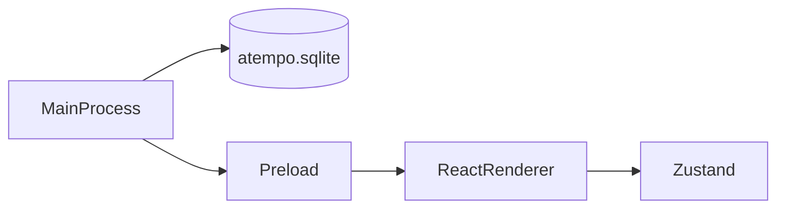

# Arquitectura de aTempo de escritorio

La aplicación tiene tres capas. Cada una vive en su carpeta y no hace el trabajo de las otras.

## Proceso principal

Carpeta: `desktop/src/main/`.

Es Node, dentro de Electron. Abre la ventana y abre SQLite. `startupHash()` mira `process.argv` y elige la ruta de arranque. Si hay varios flags, gana el primero de esta lista:

1. `--dashboard` → `/student/dashboard`.
2. `--sign-up` → `/sign-up`.
3. `--organization-dashboard` → `/organization/dashboard`.
4. `--panel` → `/teacher/panel`.

Sin ninguno de esos flags, carga el renderer sin hash. En desarrollo la ruta va detrás de `#` en `ELECTRON_RENDERER_URL`. En la app empaquetada va en la opción `hash` de `loadFile`. En los dos casos el renderer recibe `#/ruta`.

`--panel` abre la pantalla «en construcción» del panel del profesor. `--organization-dashboard` abre el Resumen de la organización.

Desde `desktop/`, `pnpm dev -- --organization-dashboard` abre directamente el Resumen de la organización sin credenciales.

La base usa la clase `DatabaseSync` de [`node:sqlite`](https://nodejs.org/api/sqlite.html). Electron 44 trae Node 24, y esa versión exporta `DatabaseSync`. El archivo es `atempo.sqlite`, en la carpeta de datos de Electron (`app.getPath('userData')`). Al arrancar se ejecuta `PRAGMA user_version = 1` para comprobar que el archivo abre. El login y el Resumen de la organización no leen ni escriben esa base.

## Preload

Carpeta: `desktop/src/preload/`.

Es el puente entre el proceso principal y la pantalla.

## Renderer

Carpeta: `desktop/src/renderer/`.

Es React. Pinta las pantallas de la app (login, registro, dashboards, escaneo e historial del alumno, y el panel en construcción) y guarda su estado en Zustand.

El enrutado es TanStack Router con hash history. `main.tsx` crea el router con `createHashHistory` y `caseSensitive: true`, y pinta `RouterProvider`. Con `caseSensitive: true` las rutas distinguen mayúsculas: `#/Sign-Up` no es `/sign-up` y muestra el login. Cada pantalla tiene su archivo en `routes/`:

- `routes/index.tsx` → `/`: el login.
- `routes/sign-up.tsx` → `/sign-up`: el registro.
- `routes/student/dashboard.tsx` → `/student/dashboard`: el dashboard del alumno (`DashboardScreen`).
- `routes/student/scan.tsx` → `/student/scan`: el registro de asistencia del alumno (`ScanScreen`).
- `routes/student/history.tsx` → `/student/history`: el historial del alumno (`HistoryScreen`).
- `routes/organization/dashboard.tsx` → `/organization/dashboard`: el Resumen de la organización (`OrganizationDashboardScreen`).
- `routes/teacher/panel.tsx` → `/teacher/panel`: `UnderConstructionScreen` con el título «Panel del profesor».
- `routes/__root.tsx`: la ruta raíz. Su `notFoundComponent` es el login, así que un hash que no es una ruta conocida también muestra el login.

`UnderConstructionScreen` (`underConstruction/UnderConstructionScreen.tsx`) es la pantalla provisional de las rutas que aún no tienen la suya. Recibe la prop `title` y pinta un `h1` con ese título y el texto «En construcción».

El plugin de TanStack Router lee `routes/` y genera `routeTree.gen.ts` al lanzar `electron-vite build` o `pnpm dev`. Ese archivo se sube a git y queda fuera de eslint y de prettier. Al añadir una ruta hay que generar el árbol con uno de esos comandos antes de `pnpm typecheck`, porque `pnpm build` comprueba los tipos antes de construir.

El panel del claim y la figura del trimestre se pintan en el renderer y no salen de la base. La figura es la constante `trimesterDays` de `trimesterExample.ts`.

El login guarda el formulario en Zustand (`loginStore.ts`). La validación está en `validateLogin.ts`. Comprueba el correo y la contraseña. No llama a la red. Con datos válidos, `submit()` busca una cuenta de alumno con ese correo:

- Si existe y la contraseña coincide, abre su sesión con `startStudentSession` y devuelve `true`.
- Si existe y la contraseña no coincide, pone bajo la contraseña «La contraseña no es la de esta cuenta.» y devuelve `false`.
- Si no existe, muestra el alert con los datos escritos y devuelve `false`.

Con datos no válidos devuelve `false`.

La sesión está en `session/sessionStore.ts`. Define los tipos `Profile` (`'student'`, `'teacher'` u `'organization'`) y `DashboardPath`, la función `dashboardPathForProfile(profile)` y el store de Zustand `useSessionStore`. El store guarda el perfil y el correo de la cuenta abierta; al arrancar los dos son `null`. `startStudentSession(email)` pone `profile: 'student'` y ese correo. El login y el registro la llaman.

`dashboardPathForProfile` da la ruta de cada perfil:

- `student` → `/student/dashboard`.
- `teacher` → `/teacher/panel`.
- `organization` → `/organization/dashboard`.

Cuando `submit()` devuelve `true`, el login navega con `navigate({ to: dashboardPathForProfile('student') })`. Si no, se queda en su pantalla.

El registro guarda el formulario en Zustand (`registerStore.ts`). La semana del registro es la constante `weekDays` de `weekExample.ts` y no sale de la base.

La validación está en `validateRegister.ts`. Comprueba el nombre, el correo, la contraseña y que la repetida coincida. No llama a la red. Con datos válidos, si el correo ya es de una cuenta, `submit()` pone bajo el correo «Ya hay una cuenta con este correo.» y devuelve `false`. Si no, crea la cuenta, abre su sesión con `startStudentSession`, devuelve `true` y el registro navega a `/student/dashboard`. «Inicia sesión» lleva al login con `navigate({ to: '/' })`, de `useNavigate()` de TanStack Router.

El Resumen de la organización vive en `organization/`. `OrganizationDashboardScreen.tsx` pinta los datos ficticios tipados de `organizationExample.ts`. No calcula asistencia ni llama a servicios.

La única métrica global es el número de estudiantes distintos con al menos 3 ausencias no justificadas en las últimas 5 sesiones o al menos 4 retrasos en las últimas 6. Quien cumple los dos patrones cuenta una sola vez. Cuando hay justificantes o correcciones pendientes, un único aviso lo explica y los cursos y estudiantes afectados lo indican. Las áreas futuras de la navegación son solo texto.

Las cuentas de alumno viven en `student/studentAccounts.ts`, en el store de Zustand `useStudentAccountsStore`. Al arrancar tiene la cuenta de ejemplo de `student/studentExample.ts`, Ada López, con su historial de clases. `findByEmail` y `recordEntry` comparan el correo sin espacios a los lados y sin distinguir mayúsculas (`normalizeEmail`). `addAccount` crea una cuenta sin clases. `recordEntry` pone una clase la primera del historial y no repite una clase que ya está. Nada de esto sale de la base.

`useCurrentStudent()`, en `student/studentAccounts.ts`, da la cuenta de la sesión abierta: busca el correo de `useSessionStore` entre las cuentas con `normalizeEmail`. Sin sesión, o si el correo no es de ninguna cuenta, da la cuenta de ejemplo. Por eso `#/student/dashboard`, `#/student/scan` y `#/student/history` sin sesión muestran a Ada López.

`student/studentExample.ts` también tiene la clase de hoy (Mié 11 nov, 09:00), el margen de tarde (`lateMinutes`, 10 minutos) y las lecturas de ejemplo del QR. `student/attendanceStatus.ts` define el tipo `AttendanceStatus` (`'presente'`, `'tarde'` o `'ausente'`), sus textos en `statusLabel` y `statusForArrival(arrival, start, lateMinutes)`, que da `'presente'` si la llegada es como mucho `start` más el margen y `'tarde'` si es después.

Las pantallas del alumno viven en `student/` y usan `useCurrentStudent()`:

- `student/dashboard/DashboardScreen.tsx` saluda con «Bienvenido» y el nombre de la cuenta. «Registrar asistencia» navega a `/student/scan` y «Resumen de asistencia» a `/student/history`, con `navigate()` de `useNavigate()`. «Próxima clase» y «Avisar de retrasos o ausencias» no hacen nada.
- `student/scan/ScanScreen.tsx` muestra la clase de hoy y el botón «Escanear», que abre el lector en un `dialog` de daisyUI. El lector no usa la cámara: ofrece las lecturas de ejemplo y «Cerrar»; «Cerrar» o el fondo lo cierran sin cambiar nada. Al elegir una lectura se cierra el lector y la pantalla muestra el resultado en un `alert` con `role="status"`:
  - Código de otra clase: «Este código no es de esta clase.» El historial no cambia.
  - La clase de hoy ya está en el historial: «Ya registraste tu entrada a las HH:MM.», con la hora de la primera lectura.
  - Si no: calcula el estado con `statusForArrival`, guarda la clase con `recordEntry` y muestra el estado y la hora, por ejemplo «Presente · 08:58».
- `student/history/HistoryScreen.tsx` lista el historial de la cuenta en su orden, de la más reciente a la más antigua. Cada fila dice la fecha, la hora de entrada («—» si es una ausencia) y el estado con su punto de color, que toma de `markClass` de `login/trimesterExample.ts`. Sin clases dice «Todavía no tienes clases.»

Escaneo e historial tienen un enlace «Volver» a `/student/dashboard`.
