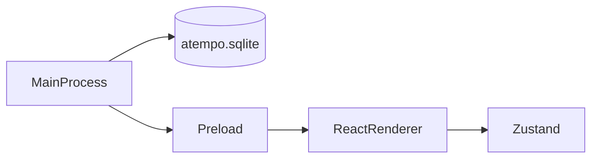

# Arquitectura de aTempo de escritorio

La aplicación tiene tres capas. Cada una vive en su carpeta y no hace el trabajo de las otras.

## Proceso principal

Carpeta: `desktop/src/main/`.

Es Node, dentro de Electron. Abre la ventana y abre SQLite. `startupHash()` selecciona el hash según los argumentos: `--organization-dashboard` abre `#/organization/dashboard`, `--dashboard` abre `#/student/dashboard` y `--sign-up` abre `#/sign-up`, en ese orden de prioridad. Sin esos argumentos, carga el renderer sin hash. En desarrollo usa `loadURL` y en compilación `loadFile` con el hash seleccionado.

Desde `desktop/`, `pnpm dev -- --organization-dashboard` abre directamente el Resumen de la organización sin credenciales.

La base usa la clase `DatabaseSync` de [`node:sqlite`](https://nodejs.org/api/sqlite.html). Electron 44 trae Node 24, y esa versión exporta `DatabaseSync`. El archivo es `atempo.sqlite`, en la carpeta de datos de Electron (`app.getPath('userData')`). Al arrancar se ejecuta `PRAGMA user_version = 1` para comprobar que el archivo abre. El login y el Resumen de la organización no leen ni escriben esa base.

## Preload

Carpeta: `desktop/src/preload/`.

Es el puente entre el proceso principal y la pantalla.

## Renderer

Carpeta: `desktop/src/renderer/`.

Es React. Pinta la pantalla de login y guarda el formulario en Zustand (`loginStore.ts`).

Sin hash, o con un hash que no es una ruta conocida, se ve el login. `#/sign-up` muestra el registro. `#/student/dashboard` muestra la maqueta del dashboard del alumno. `#/organization/dashboard` muestra el Resumen de la organización. `App.tsx` escucha `hashchange` y elige la pantalla por el hash, sin consultar el estado del login.

El panel del claim y la figura del trimestre se pintan en el renderer y no salen de la base. La figura es la constante `trimesterDays` de `trimesterExample.ts`.

La validación está en `validateLogin.ts`. Comprueba el correo y la contraseña antes de mostrar el alert. No llama a la red y no abre otra pantalla.

El registro guarda el formulario en Zustand (`registerStore.ts`). La semana del registro es la constante `weekDays` de `weekExample.ts` y no sale de la base.

La validación está en `validateRegister.ts`. Comprueba el nombre, el correo, la contraseña y que la repetida coincida antes de mostrar el alert. No llama a la red y «Inicia sesión» deja el hash de la ruta del login.

El Resumen de la organización vive en `organization/`. Reutiliza el escritorio para el prototipo visual autorizado en la issue #29; no incorpora funciones de administración. `OrganizationDashboardScreen.tsx` presenta el modelo tipado de `organizationExample.ts`, con ejemplos normal/provisional, vacío y datos incompletos. Los ejemplos tienen cifras y patrones preparados; no hay un motor de cálculo de asistencia ni consultas a servicios.

La única métrica global es el número de estudiantes distintos con al menos 3 ausencias no justificadas en las últimas 5 sesiones o al menos 4 retrasos en las últimas 6. El ejemplo incluye un estudiante con ambos patrones que cuenta una sola vez. La pantalla muestra porcentajes solo en la tabla por curso, y no incluye salidas anticipadas. Los avisos son informativos y no aplican sanciones.

Cuando el modelo es provisional, un único aviso global explica que los resultados pueden cambiar por justificantes y correcciones pendientes. Los cursos y estudiantes afectados muestran «Datos pendientes de confirmar», sin atribuirles una causa individual. El estado vacío no muestra ese aviso; el incompleto conserva la explicación de registros faltantes y muestra Sin datos cuando no hay una base válida.

La navegación identifica la página actual como Resumen y conserva las cinco áreas futuras, incluida Configuración, como texto sin navegación funcional. En ventanas estrechas se distribuyen en dos columnas y comparten un aviso de disponibilidad futura. Los datos, los avisos y el perfil son ficticios. La pantalla acepta un modelo de presentación para comprobar estados de borde sin añadir controles al producto, y utiliza los dos temas existentes.
