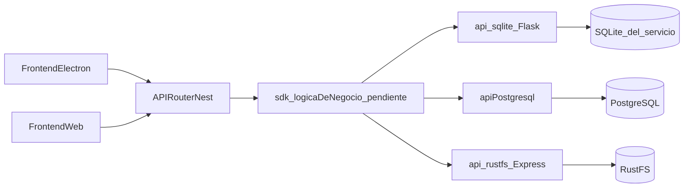
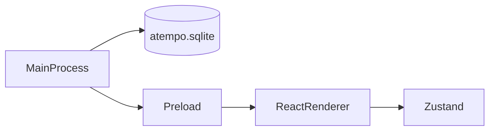

# Arquitectura de aTempo

## API-router, SDK y persistencia

Carpeta del router: `api-router/`. Persistencia relacional: `api-postgresql/` y `api-sqlite/`. Objetos en almacén S3-compatible: `api-rustfs/`.

Los frontends (Electron en `desktop/` y el futuro portal web) hablarán REST con el API-router, un servicio NestJS. El API-router transforma HTTP y delegará en la **SDK (lógica de negocio)**. Esa SDK vivirá en `sdk/`, al mismo nivel que `desktop/` y `api-router/`; la carpeta aún no existe. La SDK hablará con `api-postgresql/` para leer y escribir en PostgreSQL, con `api-sqlite/` para SQLite local y con `api-rustfs/` para objetos en RustFS. Este flujo está previsto: la SDK todavía no existe y los servicios aún no están conectados entre sí. El API-router no habla con la base ni con RustFS. Redis, Postgres y el resto de microservicios del backend quedan fuera del escritorio.

Hoy `api-router/` solo expone `GET /health`. `api-postgresql/` expone `GET /health`, los listados `GET /person`, `GET /course`, `GET /organization`, `GET /person-role` y `GET /person-course`, y `GET /person/:id` (una fila de `person` por UUID: 200, 404 o 503); con `DATABASE_URL` consulta PostgreSQL y sin ella usa un mock de prueba. `api-rustfs/` solo expone `GET /health`, que confirma que el servicio HTTP responde; su conexión S3 se comprueba aparte. `api-sqlite/` solo expone `GET /health`, que ejecuta `SELECT 1`. El login y el registro del renderer no llaman a estas APIs. Compose publica las cuatro APIs en 3000–3003. Las APIs se conectan por la red interna a PostgreSQL (`postgres:5432`) y RustFS (`rustfs:9000`); los mismos servicios también sirven al almacén operativo. PostgreSQL se publica en el host por `5433` y RustFS por `9000`/`9001`. Los volúmenes compartidos `postgres-data` y `rustfs-data`, junto con `api-sqlite-data`, conservan sus datos.

La documentación interactiva (OpenAPI y Swagger UI) de cada servicio vive en **`/docs`**. Compose publica `api-router/` en el puerto **3000**, `api-postgresql/` en el **3001**, `api-sqlite/` en el **3002** y `api-rustfs/` en el **3003**.

`sdk/` es un paquete hermano de `desktop/`, `api-router/`, `api-postgresql/`, `api-rustfs/` y `api-sqlite/`. El API-router y los frontends la consumirán cuando exista. `api-postgresql/` ya está y espera a esa SDK. `api-rustfs/` también: la SDK lo usará para objetos en RustFS.

## api-sqlite

Carpeta: `api-sqlite/`.

Servicio Flask con modelos Pydantic y consultas mediante SQLAlchemy Core. La SDK delegará aquí la persistencia local. Hoy solo expone `GET /health`, que ejecuta `SELECT 1`; responde `200` si SQLite funciona y `503` si falla la conexión. Un cuerpo JSON inválido se rechaza antes de consultar la base. Swagger UI está en `/docs` y OpenAPI en `/docs-json`. Compose sirve en el puerto **3002** y ejecuta Flask escuchando en `0.0.0.0`. `SQLITE_DATABASE_URL` apunta a `sqlite:////var/lib/atempo/api-sqlite.sqlite`; el archivo persiste en el volumen `api-sqlite-data`. El entorno virtual Linux está en `api-sqlite-venv`; ambos son independientes de `.venv` y de la base de Electron.

## api-rustfs

Carpeta: `api-rustfs/`.

Servicio Express y TypeScript. La SDK delegará en él la lectura y escritura de objetos en RustFS. Hoy solo expone `GET /health`, que confirma que el servicio HTTP responde (igual que `api-router/`). Swagger UI en **`/docs`** y OpenAPI en **`/docs-json`**, igual que en `api-router/`. Compose lo sirve en el puerto **3003** y conecta al servicio interno `rustfs:9000`. `/health` no comprueba RustFS; el workflow valida S3 aparte. El volumen compartido `rustfs-data` conserva los objetos. RustFS publica el puerto S3 `9000` y la consola `9001` en el host.

## api-postgresql

`api-postgresql/` sirve NestJS en el puerto **3001**. Compose inicia PostgreSQL con el servicio interno `postgres` y espera a su healthcheck antes de arrancar la API. `GET /health` confirma la conexión. `ATEMPO_POSTGRES_PASSWORD` es obligatoria y `POSTGRES_PASSWORD` es su alternativa; ambas se leen desde `.env` ignorado por Git. Las APIs no montan el `.env`; Compose pasa solo las variables necesarias. PostgreSQL 17.12 comparte el volumen `postgres-data` y se publica en el host por `5433`; la API usa `postgres:5432`. Un volumen creado con PostgreSQL 16 requiere copia de seguridad y migración explícita antes de usarse con 17. CI usa un valor efímero.

## Almacenes

Carpetas: `postgres/`, `sqlite/`, `rustfs/`, `blockend/`.

Son almacenes y cadena, no una capa del escritorio ni del API-router. Cada una tiene un cliente solo para consultar (Drizzle Studio, Datasette, consola de RustFS, Otterscan). Se instalan y arrancan en el ordenador. Compose de la raíz orquesta los mismos procesos; los perfiles quedan para las herramientas auxiliares y no son requisito para iniciar las APIs. PostgreSQL y RustFS comparten servicio y volumen de datos con sus APIs. Ninguna importa NestJS, Electron ni React. El SQLite de `desktop/src/main/database.ts` (`atempo.sqlite`) es la base local del profesor; `sqlite/` es otro almacén, el operativo de fichaje.

El modelo y los enlaces están en `docs/POSTGRES.md`, `docs/SQLITE.md`, `docs/RUSTFS.md`, `docs/BLOCKEND.md` y `permanent-data.md`.

`api-postgresql/` comprueba la conexión con `GET /health`, ofrece cinco listados (incluidos `GET /organization` y `GET /person-course`) y `GET /person/:id`. `api-rustfs/` no abre RustFS en el health. El renderer y el API-router no abren estas bases. La SDK las usará cuando exista.

## aTempo de escritorio

La aplicación de escritorio tiene tres capas. Cada una vive en su carpeta y no hace el trabajo de las otras.

## Proceso principal

Carpeta: `desktop/src/main/`.

Es Node, dentro de Electron. Abre la ventana y abre SQLite. `startupHash()` mira `process.argv` y elige la ruta de arranque. Si hay varios flags, gana el primero de esta lista:

1. `--dashboard` → `/student/dashboard`.
2. `--sign-up` → `/sign-up`.
3. `--organization-dashboard` → `/organization/dashboard`.

Sin ninguno de esos flags, carga el renderer sin hash y muestra el login. En desarrollo la ruta va detrás de `#` en `ELECTRON_RENDERER_URL`. En la app empaquetada va en la opción `hash` de `loadFile`. En los dos casos el renderer recibe `#/ruta`.

Tras el arranque normal, el login valida la cuenta del profesor o del alumno y TanStack Router abre el dashboard de su perfil al pulsar «Entrar». `--organization-dashboard` abre el Resumen de la organización.

Desde `desktop/`, `pnpm dev -- --organization-dashboard` abre directamente el Resumen de la organización sin credenciales.

La base usa la clase `DatabaseSync` de [`node:sqlite`](https://nodejs.org/api/sqlite.html). Electron 44 trae Node 24, y esa versión exporta `DatabaseSync`. El archivo es `atempo.sqlite`, en la carpeta de datos de Electron (`app.getPath('userData')`). Al arrancar se ejecuta `PRAGMA user_version = 1` para comprobar que el archivo abre. Los prototipos de login, registro, alumno, panel del profesor y Resumen de la organización no leen ni escriben esa base.

## Preload

Carpeta: `desktop/src/preload/`.

Es el puente entre el proceso principal y la pantalla.

## Renderer

Carpeta: `desktop/src/renderer/`.

Es React. Pinta las pantallas de la app (login, registro, dashboards, escaneo e historial del alumno, y el panel del profesor) y guarda su estado en Zustand.

El enrutado es TanStack Router con hash history. `main.tsx` crea el router con `createHashHistory` y `caseSensitive: true`, y pinta `RouterProvider`. Con `caseSensitive: true` las rutas distinguen mayúsculas: `#/Sign-Up` no es `/sign-up` y muestra el login. Cada pantalla tiene su archivo en `routes/`:

- `routes/index.tsx` → `/`: el login.
- `routes/sign-up.tsx` → `/sign-up`: el registro.
- `routes/student/dashboard.tsx` → `/student/dashboard`: el dashboard del alumno (`DashboardScreen`).
- `routes/student/scan.tsx` → `/student/scan`: el registro de asistencia del alumno (`ScanScreen`).
- `routes/student/history.tsx` → `/student/history`: el historial del alumno (`HistoryScreen`).
- `routes/organization/dashboard.tsx` → `/organization/dashboard`: el Resumen de la organización (`OrganizationDashboardScreen`).
- `routes/teacher/panel.tsx` → `/teacher/panel`: el panel del profesor (`PanelScreen`).
- `routes/__root.tsx`: la ruta raíz. Su `notFoundComponent` es el login, así que un hash que no es una ruta conocida también muestra el login.

`UnderConstructionScreen` (`underConstruction/UnderConstructionScreen.tsx`) sigue disponible como componente provisional; ninguna de las rutas actuales lo usa. Recibe la prop `title` y pinta un `h1` con ese título y el texto «En construcción».

El plugin de TanStack Router lee `routes/` y genera `routeTree.gen.ts` al lanzar `electron-vite build` o `pnpm dev`. Ese archivo se sube a git y queda fuera de eslint y de prettier. Al añadir una ruta hay que generar el árbol con uno de esos comandos antes de `pnpm typecheck`, porque `pnpm build` comprueba los tipos antes de construir.

El panel del claim y la figura del trimestre se pintan en el renderer y no salen de la base. La figura es la constante `trimesterDays` de `trimesterExample.ts`.

El login guarda el formulario en Zustand (`loginStore.ts`). `validateLogin.ts` comprueba el formato del correo y los campos obligatorios. Después, `submit()` normaliza el correo con `normalizeEmail` (`trim().toLowerCase()`) y compara primero con la cuenta pública de `teacherDemoAccount.ts`: `profesor@atempo.test` / `Profesor123!`. La contraseña debe coincidir exactamente. Si coincide, guarda `profile: 'teacher'` y el correo normalizado en la sesión, vacía el formulario (correo y contraseña) y devuelve `true`. El correo sigue guardado en la sesión.

Para otros correos, busca una cuenta en `useStudentAccountsStore`: la demo `ada.lopez@clase.test` / `clase-2026` o un alumno registrado durante ese arranque. Si la contraseña coincide, abre su sesión con `startStudentSession(account.email)`, vacía el formulario y devuelve `true`. Cualquier fallo (correo desconocido o contraseña incorrecta, de profesor o de alumno) muestra el mismo alert de error, para no revelar qué correos tienen cuenta. Los fallos devuelven `false`, sin crear sesión, navegar ni repetir las credenciales en el aviso. El login no llama a la red. Al salir de la pantalla, `LoginForm` llama a `reset()` y el formulario se vacía, también tras un intento fallido.

La sesión está en `session/sessionStore.ts`. Define los tipos `Profile` (`'student'`, `'teacher'` u `'organization'`) y `DashboardPath`, la función `dashboardPathForProfile(profile)` y el store de Zustand `useSessionStore`, con `profile: null` y `email: null` al arrancar. `startStudentSession(email)` pone el perfil de alumno y su correo; la usan el login y el registro de alumnos. La sesión y las cuentas mock viven en memoria: al recargar el renderer o reiniciar la app se vacía la sesión, se pierden los alumnos registrados y se restablecen los datos de ejemplo. Para repetir ambos accesos desde el login se reinicia la app.

`dashboardPathForProfile` da la ruta de cada perfil:

- `student` → `/student/dashboard`.
- `teacher` → `/teacher/panel`.
- `organization` → `/organization/dashboard`.

Tras un envío correcto, el login lee el perfil actualizado con `useSessionStore.getState()` y navega con `navigate({ to: dashboardPathForProfile(profile) })`. El profesor abre Hoy en `/teacher/panel` y el alumno, `/student/dashboard`. Un envío fallido conserva la ruta del login.

El panel del profesor está en `desktop/src/renderer/src/panel/`. La lista, las sesiones y la asistencia de ejemplo viven en memoria, en `roster.ts`. El estado de esa pantalla está en `panelStore.ts`. El margen de retraso y los avisos de ejemplo están en `settingsStore.ts`. Todo ese estado vive en Zustand, dentro del renderer, y vuelve a los datos de ejemplo al cerrar la aplicación.

Al abrir la lista, el store guarda `openedAt`. `SessionQr` muestra una cuadrícula sintética identificada como «QR de ejemplo»: deriva el patrón de la apertura y del periodo de 30 segundos transcurrido según `Date.now()`. La cuenta atrás redondea hacia arriba y vuelve a 30 en cada límite. Un intervalo actualiza la vista; `visibilitychange` y `focus` recuperan el periodo actual sin reproducir ticks perdidos. Al cerrar la lista, salir de Hoy o abrir una ficha, el componente se desmonta y limpia el intervalo y las escuchas. Navegar conserva `openedAt`; volver a abrir la lista lo renueva. Este ejemplo local no genera ni valida códigos QR reales, ni implementa autenticación o protección frente a capturas. El lector de ejemplo del alumno usa sus propias lecturas mock y no consume este patrón. La generación y validación reales en backend, la cámara y la versión web quedan para tareas posteriores.

«Simular llegada» toma el siguiente alumno pendiente en el orden de `rosterNames`, con hora válida en `todayEntry` y sin hora corregida manualmente. El store comprueba la fase abierta, el índice, la hora y que la llegada no esté duplicada; guarda hora y estado en una actualización. El estado sale de `statusForArrival` (la misma regla que el alumno): Tarde si la hora supera el inicio del curso más el margen de Ajustes, y Presente en caso contrario. Si cambia la hora que se ve de un alumno que ya está Presente o Tarde, el estado se vuelve a calcular con ella (`rollTime` da esa hora: la corregida o, si no hay, la del registro). Si la hora que se ve no cambia, por ejemplo al abrir la hora y salir sin tocarla o al borrar una hora que no se había corregido, se respeta la marca puesta a mano. La hora escrita para un alumno pendiente no lo marca como llegado. Un alumno Ausente no tiene hora: su fila no ofrece editarla, `setTime` la ignora, y marcarlo ausente o cerrar la lista (los pendientes pasan a ausentes) borra la que tuviera.

El menú de estado se puede usar con teclado: al abrirlo, el foco pasa a la primera opción; Tab recorre las opciones; al elegir una o pulsar Escape, el foco vuelve al botón de la fila. Se cierra si el foco o un clic van a otro control, al desplazar y al cambiar el tamaño de la ventana. La rotación no registra asistencia y el botón se deshabilita cuando no quedan candidatos.

`demoArrivals` conserva únicamente los índices con llegada simulada aceptada. Para esas filas de Hoy, `MarkControl` omite Ausente y `setMark` rechaza Ausente/Pendiente; siguen permitidas las correcciones de Presente/Tarde y hora. Las demás filas y los controles históricos mantienen sus opciones. Cerrar y volver a abrir conservan marcas, horas y evidencia de llegada; `openSession` inicia una sesión nueva y vacía los tres registros. Cancelar el cierre conserva el periodo abierto.

El registro guarda el formulario en Zustand (`registerStore.ts`). La semana del registro es la constante `weekDays` de `weekExample.ts` y no sale de la base.

La validación está en `validateRegister.ts`. Comprueba el nombre, el correo, la contraseña y que la repetida coincida. No llama a la red. Con datos válidos, si el correo normalizado está reservado al profesor o ya es de una cuenta de alumno, `submit()` pone bajo el correo «Ya hay una cuenta con este correo.» y devuelve `false`. Si no, crea la cuenta, abre su sesión con `startStudentSession`, vacía el formulario (también las dos contraseñas), devuelve `true` y el registro navega a `/student/dashboard`. La cuenta creada, con su contraseña, sigue en `useStudentAccountsStore` mientras la app está abierta: es un prototipo sin backend. Al salir de la pantalla, `RegisterForm` llama a `reset()` y el formulario se vacía aunque no se haya creado la cuenta. «Inicia sesión» lleva al login con `navigate({ to: '/' })`, de `useNavigate()` de TanStack Router.

El Resumen de la organización vive en `organization/`. `OrganizationDashboardScreen.tsx` pinta los datos ficticios tipados de `organizationExample.ts`. No calcula asistencia ni llama a servicios.

La única métrica global es el número de estudiantes distintos con al menos 3 ausencias no justificadas en las últimas 5 sesiones o al menos 4 retrasos en las últimas 6. Quien cumple los dos patrones cuenta una sola vez. Cuando hay justificantes o correcciones pendientes, un único aviso lo explica y los cursos y estudiantes afectados lo indican. Las áreas futuras de la navegación son solo texto.

Las cuentas de alumno viven en `student/studentAccounts.ts`, en el store de Zustand `useStudentAccountsStore`. Al arrancar tiene la cuenta de ejemplo de `student/studentExample.ts`, Ada López, con su historial de clases. `findByEmail` y `recordEntry` comparan el correo sin espacios a los lados y sin distinguir mayúsculas (`normalizeEmail`). `addAccount` crea una cuenta sin clases. `recordEntry` pone una clase la primera del historial y no repite una clase que ya está. Nada de esto sale de la base.

`useCurrentStudent()`, en `student/studentAccounts.ts`, da la cuenta de la sesión abierta: busca el correo de `useSessionStore` entre las cuentas con `normalizeEmail`. Sin sesión da la cuenta de ejemplo del propio store, con su historial actualizado. Por eso `#/student/dashboard`, `#/student/scan` y `#/student/history` sin sesión muestran a Ada López. Si la sesión no es de alumno (por ejemplo, la del profesor) o su correo no es de ninguna cuenta, da `null` y esas pantallas muestran `NoStudentSession` («No hay una sesión de alumno»): nunca enseñan ni guardan datos de otra persona.

`student/studentExample.ts` también tiene la clase de hoy (Mié 11 nov, 09:00), el margen de tarde (`lateMinutes`, 10 minutos) y las lecturas de ejemplo del QR. `student/attendanceStatus.ts` define el tipo `AttendanceStatus` (`'presente'`, `'tarde'` o `'ausente'`), sus textos en `statusLabel` y `statusForArrival(arrival, start, lateMinutes)`, que da `'presente'` si la llegada es como mucho `start` más el margen y `'tarde'` si es después.

Las pantallas del alumno viven en `student/` y usan `useCurrentStudent()`:

- `student/dashboard/DashboardScreen.tsx` saluda con «Bienvenido» y el nombre de la cuenta. «Registrar asistencia» navega a `/student/scan` y «Resumen de asistencia» a `/student/history`, con `navigate()` de `useNavigate()`. «Próxima clase» y «Avisar de retrasos o ausencias» no hacen nada.
- `student/scan/ScanScreen.tsx` muestra la clase de hoy y el botón «Escanear», que abre el lector en un `dialog` de daisyUI. El lector no usa la cámara: ofrece las lecturas de ejemplo y «Cerrar»; «Cerrar» o el fondo lo cierran sin cambiar nada. Al elegir una lectura se cierra el lector y la pantalla muestra el resultado en un `alert` con `role="status"`:
  - Código de otra clase: «Este código no es de esta clase.» El historial no cambia.
  - La clase de hoy ya está en el historial: «Ya registraste tu entrada a las HH:MM.», con la hora de la primera lectura.
  - Si no: calcula el estado con `statusForArrival`, guarda la clase con `recordEntry` y muestra el estado y la hora, por ejemplo «Presente · 08:58».
- `student/history/HistoryScreen.tsx` lista el historial de la cuenta en su orden, de la más reciente a la más antigua. Cada fila dice la fecha, la hora de entrada («—» si es una ausencia) y el estado con su punto de color, que toma de `markClass` de `login/trimesterExample.ts`. Sin clases dice «Todavía no tienes clases.»

Escaneo e historial tienen un enlace «Volver» a `/student/dashboard`.

## Pruebas de escritorio

Las suites Playwright lanzan el build real a través de `desktop/tests/helpers/electron.ts`. El arnés de tests comprueba la fuente y el build antes del arranque e instala guardas nativas antes de cargar el main. En macOS mantiene las ventanas ocultas, bloquea su activación y vigila el primer plano y el cierre de los procesos propios, con auditoría persistente. Aborta si no puede observar o mantener esas condiciones; no admite un arranque visible. El smoke obligatorio y los comandos están en [README.md](../README.md#escritorio).

El arnés vive exclusivamente en `desktop/tests/`: el arranque normal y las capas de la aplicación conservan su comportamiento.
## Entorno de instalación

Docker instala lo que el proyecto necesita con versiones comunes para el equipo: Node 24.22.3, pnpm 10.33.0 y APM 0.35.0. La imagen también instala Python 3.13 para ejecutar `api-sqlite/`; APM conserva además su propio Python integrado. La instalación se define en `Dockerfile`, `docker-compose.yml` y `docker/setup.sh`.

- La imagen parte de `node:24.22.3-trixie`. El binario oficial de APM se comprueba con su SHA-256. Python 3.13 y su soporte de venv se instalan desde un snapshot Debian fijado.
- `setup` ejecuta `apm install`, instala con lockfiles los paquetes Node de escritorio, Storybook, las APIs, `blockend/` y `postgres/`, y prepara el venv de `api-sqlite/`.
- Las skills y agentes de delivery-workflow quedan en la carpeta del proyecto para Cursor, Codex y Claude Code.
- Los `node_modules` y el venv Python viven en volúmenes Docker separados por paquete; pnpm comparte su caché. Las dependencias Linux no se mezclan con las del ordenador.
- Compose sirve Storybook en 6006 y las APIs en 3000–3003. Las APIs alcanzan PostgreSQL y RustFS mediante sus nombres de servicio, y esos almacenes también conservan los puertos host de desarrollo. Los datos de `api-sqlite`, PostgreSQL y RustFS viven en volúmenes independientes.
- Compose también ofrece perfiles para PostgreSQL operativo, SQLite operativo, RustFS de justificantes y blockend, documentados en el README. `desktop` ejecuta las comprobaciones de su paquete y `blockend` las de Hardhat.
- El workflow `.github/workflows/docker-apis.yml` valida la instalación limpia y repetida, las APIs y sus datos persistentes en Ubuntu.
- `desktop-gui`, opcional, usa la etapa gráfica del Dockerfile, con librerías fijadas desde un snapshot Debian. Abre Electron en el servidor X11 del ordenador y se activa con el perfil `gui`.
- Los hooks de `.githooks/` ejecutan `setup` tras pull, cambio de rama o rebase cuando cambian los manifiestos, lockfiles, scripts de instalación o Dockerfile. Reconstruyen la imagen si hace falta; si Docker no está en marcha, avisan y git continúa.

Docker es el instalador, no el entorno de trabajo. Cursor y Codex se usan sobre todo desde sus apps de escritorio, y esas apps trabajan sobre la carpeta del ordenador: el agente lanza allí sus comandos, no dentro de un contenedor. Por eso cada ordenador sigue necesitando `git`, `gh`, Node y bash para el flujo de delivery-workflow, y la ventana de Electron se abre en el ordenador. `desktop-gui` puede abrirla desde Docker en la pantalla del ordenador, a través de X11, pero es opcional y experimental.

Se descartó trabajar dentro de un Dev Container:

| | Docker como instalador | Dev Container |
| --- | --- | --- |
| App de escritorio de Codex | Funciona | No abre proyectos dentro de un contenedor |
| App de escritorio de Cursor | Funciona | Con su extensión de Dev Containers, que falla a menudo |
| Ventana de Electron | En el ordenador, o desde Docker con `desktop-gui` y X11 | Sin pantalla dentro del contenedor |
| Lo que necesita cada ordenador | Docker, git, `gh`, Node y bash | Docker y git |
| Windows | WSL o Git Bash para el flujo | Resuelto: el contenedor es Linux |

`.devcontainer/devcontainer.json` usa la misma imagen para quien pueda abrir un Dev Container. Es opcional.
