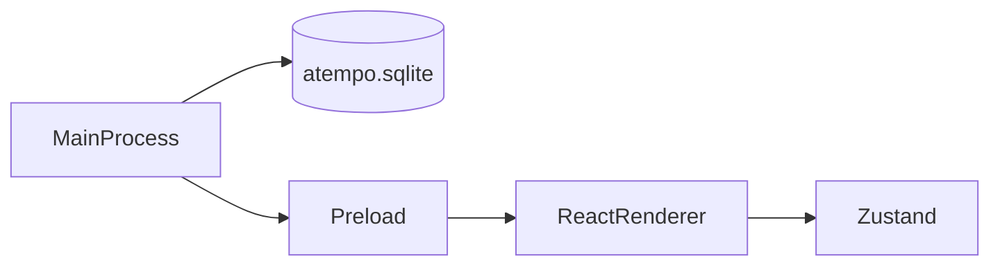

# Arquitectura de aTempo de escritorio

La aplicación tiene tres capas. Cada una vive en su carpeta y no hace el trabajo de las otras.

## Proceso principal

Carpeta: `desktop/src/main/`.

Es Node, dentro de Electron. Abre la ventana y abre SQLite.

La base usa la clase `DatabaseSync` de [`node:sqlite`](https://nodejs.org/api/sqlite.html). Electron 44 trae Node 24, y esa versión exporta `DatabaseSync`. El archivo es `atempo.sqlite`, en la carpeta de datos de Electron (`app.getPath('userData')`). Al arrancar se ejecuta `PRAGMA user_version = 1` para comprobar que el archivo abre. El login no lee ni escribe esa base.

## Preload

Carpeta: `desktop/src/preload/`.

Es el puente entre el proceso principal y la pantalla. La pantalla de login no necesita datos del proceso principal, así que este puente no expone ninguna función.

## Renderer

Carpeta: `desktop/src/renderer/`.

Es React. Pinta la pantalla de login y guarda el formulario en Zustand (`loginStore.ts`).

El panel del claim y la figura del trimestre se pintan en el renderer y no salen de la base. La figura es la constante `trimesterDays` de `trimesterExample.ts`.

La validación está en `validateLogin.ts`. Comprueba el correo y la contraseña antes de mostrar el alert. No llama a la red y no abre otra pantalla.

### Registro

Carpeta: `desktop/src/renderer/src/register/`.

La pantalla de registro pide el nombre completo, el correo y la contraseña. La contraseña tiene un botón para mostrarla u ocultarla. El formulario se guarda en Zustand (`registerStore.ts`) y lo valida `validateRegister.ts`: el nombre es obligatorio, el correo tiene que tener forma de correo y la contraseña necesita 8 caracteres o más. Con los datos bien, sale un alert. No llama a la red y no toca SQLite.

Todavía no hay ningún enlace al registro. `App.tsx` lo muestra solo si la URL acaba en `#registro`, y así lo abren los tests.

### Componentes compartidos

Carpeta: `desktop/src/renderer/src/components/`.

`ClaimPanel.tsx` pinta el panel del claim y del trimestre. Lo usan el login y el registro. La figura del trimestre sale de `trimesterExample.ts`, en la misma carpeta.
