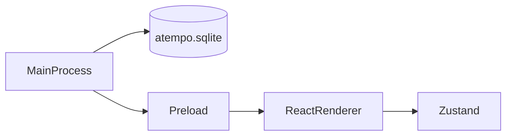

# Arquitectura de aTempo de escritorio

La aplicación tiene tres capas. Cada una vive en su carpeta y no hace el trabajo de las otras.

## Proceso principal

Carpeta: `desktop/src/main/`.

Es Node, dentro de Electron. Abre la ventana y abre SQLite. `startupHash()` mira `process.argv` y elige la ruta de arranque. Si hay varios flags, gana el primero de esta lista:

1. `--dashboard` → `/student/dashboard`.
2. `--sign-up` → `/sign-up`.
3. `--organization-dashboard` → `/organization/dashboard`.
4. `--panel` → `/teacher/panel`.

Sin ninguno de esos flags, carga el renderer sin hash. En desarrollo la ruta va detrás de `#` en `ELECTRON_RENDERER_URL`. En la app empaquetada va en la opción `hash` de `loadFile`. En los dos casos el renderer recibe `#/ruta`.

`--organization-dashboard` y `--panel` muestran la pantalla «en construcción» de su ruta.

La base usa la clase `DatabaseSync` de [`node:sqlite`](https://nodejs.org/api/sqlite.html). Electron 44 trae Node 24, y esa versión exporta `DatabaseSync`. El archivo es `atempo.sqlite`, en la carpeta de datos de Electron (`app.getPath('userData')`). Al arrancar se ejecuta `PRAGMA user_version = 1` para comprobar que el archivo abre. El login no lee ni escribe esa base.

## Preload

Carpeta: `desktop/src/preload/`.

Es el puente entre el proceso principal y la pantalla.

## Renderer

Carpeta: `desktop/src/renderer/`.

Es React. Pinta las pantallas de la app (login, registro, dashboard del alumno y las pantallas en construcción) y guarda su estado en Zustand.

El enrutado es TanStack Router con hash history. `main.tsx` crea el router con `createHashHistory` y `caseSensitive: true`, y pinta `RouterProvider`. Con `caseSensitive: true` las rutas distinguen mayúsculas: `#/Sign-Up` no es `/sign-up` y muestra el login. Cada pantalla tiene su archivo en `routes/`:

- `routes/index.tsx` → `/`: el login.
- `routes/sign-up.tsx` → `/sign-up`: el registro.
- `routes/student/dashboard.tsx` → `/student/dashboard`: la maqueta del dashboard del alumno.
- `routes/organization/dashboard.tsx` → `/organization/dashboard`: `UnderConstructionScreen` con el título «Dashboard de organización».
- `routes/teacher/panel.tsx` → `/teacher/panel`: `UnderConstructionScreen` con el título «Panel del profesor».
- `routes/__root.tsx`: la ruta raíz. Su `notFoundComponent` es el login, así que un hash que no es una ruta conocida también muestra el login.

`UnderConstructionScreen` (`underConstruction/UnderConstructionScreen.tsx`) es la pantalla provisional de las rutas que aún no tienen la suya. Recibe la prop `title` y pinta un `h1` con ese título y el texto «En construcción».

El plugin de TanStack Router lee `routes/` y genera `routeTree.gen.ts` al lanzar `electron-vite build` o `pnpm dev`. Ese archivo se sube a git y queda fuera de eslint y de prettier. Al añadir una ruta hay que generar el árbol con uno de esos comandos antes de `pnpm typecheck`, porque `pnpm build` comprueba los tipos antes de construir.

El panel del claim y la figura del trimestre se pintan en el renderer y no salen de la base. La figura es la constante `trimesterDays` de `trimesterExample.ts`.

El login guarda el formulario en Zustand (`loginStore.ts`). La validación está en `validateLogin.ts`. Comprueba el correo y la contraseña antes de mostrar el alert. No llama a la red. `submit()` devuelve `true` si el envío es válido y `false` si no.

La sesión está en `session/sessionStore.ts`. Define los tipos `Profile` (`'student'`, `'teacher'` u `'organization'`) y `DashboardPath`, la función `dashboardPathForProfile(profile)` y el store de Zustand `useSessionStore`, con `profile: null` al arrancar. Hoy nada escribe `profile`.

`dashboardPathForProfile` da la ruta de cada perfil:

- `student` → `/student/dashboard`.
- `teacher` → `/teacher/panel`.
- `organization` → `/organization/dashboard`.

Tras un envío válido, si hay perfil, el login navega a esa ruta con `navigate({ to: dashboardPathForProfile(profile) })`. Si `profile` es `null`, muestra el alert y no navega. Como hoy `profile` siempre es `null`, el login se queda en su pantalla.

El registro guarda el formulario en Zustand (`registerStore.ts`). La semana del registro es la constante `weekDays` de `weekExample.ts` y no sale de la base.

La validación está en `validateRegister.ts`. Comprueba el nombre, el correo, la contraseña y que la repetida coincida antes de mostrar el alert. No llama a la red. «Inicia sesión» lleva al login con `navigate({ to: '/' })`, de `useNavigate()` de TanStack Router.
