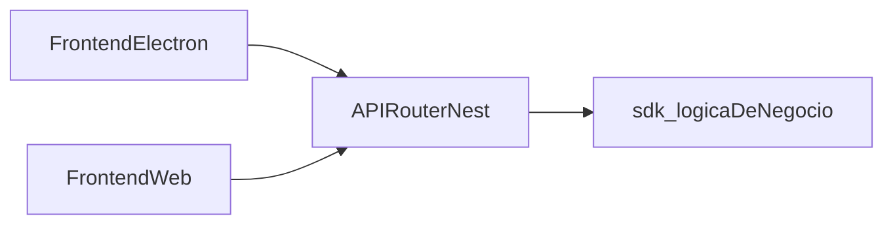
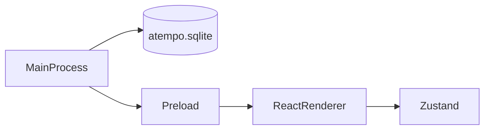

# Arquitectura de aTempo

## API-router y SDK

Carpeta: `api-router/`.

Los frontends (Electron en `desktop/` y el futuro portal web) hablarán REST con este servicio NestJS. El API-router transforma HTTP y delegará en la **SDK (lógica de negocio)**. Esa SDK vivirá en `sdk/`, al mismo nivel que `desktop/` y `api-router/`; la carpeta aún no existe. Redis, Postgres y el resto de microservicios del backend quedan fuera del escritorio.

Hoy solo existe `GET /health`. El login y el registro del renderer **no** llaman a esta API.

La documentación interactiva (OpenAPI y Swagger UI) vive en **`/docs`** con el servicio en marcha; sirve para probar endpoints a mano, no implementa lógica de negocio.

`sdk/` es un paquete hermano de `desktop/` y `api-router/`; el API-router y los frontends la consumirán cuando exista.

## aTempo de escritorio

La aplicación de escritorio tiene tres capas. Cada una vive en su carpeta y no hace el trabajo de las otras.

## Proceso principal

Carpeta: `desktop/src/main/`.

Es Node, dentro de Electron. Abre la ventana y abre SQLite. `startupHash()` mira `process.argv` y elige la ruta de arranque. Si hay varios flags, gana el primero de esta lista:

1. `--dashboard` → `/student/dashboard`.
2. `--sign-up` → `/sign-up`.
3. `--organization-dashboard` → `/organization/dashboard`.

Sin ninguno de esos flags, carga el renderer sin hash y muestra el login. En desarrollo la ruta va detrás de `#` en `ELECTRON_RENDERER_URL`. En la app empaquetada va en la opción `hash` de `loadFile`. En los dos casos el renderer recibe `#/ruta`.

Tras el arranque normal, TanStack Router abre el panel del profesor cuando el hash del renderer cambia a `#/teacher/panel`. `--organization-dashboard` abre el Resumen de la organización.

Desde `desktop/`, `pnpm dev -- --organization-dashboard` abre directamente el Resumen de la organización sin credenciales.

La base usa la clase `DatabaseSync` de [`node:sqlite`](https://nodejs.org/api/sqlite.html). Electron 44 trae Node 24, y esa versión exporta `DatabaseSync`. El archivo es `atempo.sqlite`, en la carpeta de datos de Electron (`app.getPath('userData')`). Al arrancar se ejecuta `PRAGMA user_version = 1` para comprobar que el archivo abre. El login y el Resumen de la organización no leen ni escriben esa base.

## Preload

Carpeta: `desktop/src/preload/`.

Es el puente entre el proceso principal y la pantalla.

## Renderer

Carpeta: `desktop/src/renderer/`.

Es React. Pinta las pantallas de la app (login, registro, dashboards y el panel del profesor) y guarda su estado en Zustand.

El enrutado es TanStack Router con hash history. `main.tsx` crea el router con `createHashHistory` y `caseSensitive: true`, y pinta `RouterProvider`. Con `caseSensitive: true` las rutas distinguen mayúsculas: `#/Sign-Up` no es `/sign-up` y muestra el login. Cada pantalla tiene su archivo en `routes/`:

- `routes/index.tsx` → `/`: el login.
- `routes/sign-up.tsx` → `/sign-up`: el registro.
- `routes/student/dashboard.tsx` → `/student/dashboard`: la maqueta del dashboard del alumno.
- `routes/organization/dashboard.tsx` → `/organization/dashboard`: el Resumen de la organización (`OrganizationDashboardScreen`).
- `routes/teacher/panel.tsx` → `/teacher/panel`: el panel del profesor (`PanelScreen`).
- `routes/__root.tsx`: la ruta raíz. Su `notFoundComponent` es el login, así que un hash que no es una ruta conocida también muestra el login.

`UnderConstructionScreen` (`underConstruction/UnderConstructionScreen.tsx`) es la pantalla provisional de las rutas que aún no tienen la suya. Recibe la prop `title` y pinta un `h1` con ese título y el texto «En construcción».

El plugin de TanStack Router lee `routes/` y genera `routeTree.gen.ts` al lanzar `electron-vite build` o `pnpm dev`. Ese archivo se sube a git y queda fuera de eslint y de prettier. Al añadir una ruta hay que generar el árbol con uno de esos comandos antes de `pnpm typecheck`, porque `pnpm build` comprueba los tipos antes de construir.

El panel del claim y la figura del trimestre se pintan en el renderer y no salen de la base. La figura es la constante `trimesterDays` de `trimesterExample.ts`.

El login guarda el formulario en Zustand (`loginStore.ts`). La validación está en `validateLogin.ts`. Comprueba el correo y la contraseña antes de mostrar el alert. No llama a la red. `submit()` devuelve `true` si el envío es válido y `false` si no.

La sesión está en `session/sessionStore.ts`. Define los tipos `Profile` (`'student'`, `'teacher'` u `'organization'`) y `DashboardPath`, la función `dashboardPathForProfile(profile)` y el store de Zustand `useSessionStore`, con `profile: null` al arrancar. Hoy nada escribe `profile`.

`dashboardPathForProfile` da la ruta de cada perfil:

- `student` → `/student/dashboard`.
- `teacher` → `/teacher/panel`.
- `organization` → `/organization/dashboard`.

Tras un envío válido, si hay perfil, el login navega a esa ruta con `navigate({ to: dashboardPathForProfile(profile) })`. Si `profile` es `null`, muestra el alert y no navega. Como hoy `profile` siempre es `null`, el login se queda en su pantalla.

El panel del profesor está en `desktop/src/renderer/src/panel/`. La lista, las sesiones y la asistencia de ejemplo viven en memoria, en `roster.ts`. El estado de esa pantalla está en `panelStore.ts`. El margen de retraso y los avisos de ejemplo están en `settingsStore.ts`. Todo ese estado vive en Zustand, dentro del renderer, y vuelve a los datos de ejemplo al cerrar la aplicación.

El registro guarda el formulario en Zustand (`registerStore.ts`). La semana del registro es la constante `weekDays` de `weekExample.ts` y no sale de la base.

La validación está en `validateRegister.ts`. Comprueba el nombre, el correo, la contraseña y que la repetida coincida antes de mostrar el alert. No llama a la red. «Inicia sesión» lleva al login con `navigate({ to: '/' })`, de `useNavigate()` de TanStack Router.

El Resumen de la organización vive en `organization/`. `OrganizationDashboardScreen.tsx` pinta los datos ficticios tipados de `organizationExample.ts`. No calcula asistencia ni llama a servicios.

La única métrica global es el número de estudiantes distintos con al menos 3 ausencias no justificadas en las últimas 5 sesiones o al menos 4 retrasos en las últimas 6. Quien cumple los dos patrones cuenta una sola vez. Cuando hay justificantes o correcciones pendientes, un único aviso lo explica y los cursos y estudiantes afectados lo indican. Las áreas futuras de la navegación son solo texto.

## Pruebas de escritorio

Las suites Playwright lanzan el build real a través de `desktop/tests/helpers/electron.ts`. El arnés de tests comprueba la fuente y el build antes del arranque e instala guardas nativas antes de cargar el main. En macOS mantiene las ventanas ocultas, bloquea su activación y vigila el primer plano y el cierre de los procesos propios, con auditoría persistente. Aborta si no puede observar o mantener esas condiciones; no admite un arranque visible. El smoke obligatorio y los comandos están en [README.md](../README.md#escritorio).

El arnés vive exclusivamente en `desktop/tests/`: el arranque normal y las capas de la aplicación conservan su comportamiento.
## Entorno de instalación

Docker instala lo que el proyecto necesita con las mismas versiones para todo el equipo: Node 24.22.3, que es la versión mayor de Electron 44, pnpm 10.33.0 y APM 0.35.0. Está en `Dockerfile`, `docker-compose.yml` y `docker/setup.sh`.

- La imagen parte de `node:24.22.3-trixie`, con la versión exacta. APM llega como su binario oficial para Linux, comprobado con su SHA-256: trae su propio Python, así que la imagen no instala ninguno. El binario necesita glibc 2.38 o superior, y por eso la base es Debian 13 (trixie) y no Debian 12.
- `setup` lanza `apm install` en la raíz y `pnpm install` en `desktop/`, `docs/storybook/` y `api-router/`.
- Las skills y los agentes de delivery-workflow quedan en la carpeta del proyecto, para Cursor, Codex y Claude Code. Son texto y valen en cualquier sistema.
- Los `node_modules` quedan en volúmenes de Docker. Los de Linux no sirven en macOS ni en Windows, ni al revés: Electron, SQLite y Vite traen binarios de cada sistema.
- `desktop/`, `docs/storybook/` y `api-router/` tienen cada uno su `node_modules`, porque cada uno tiene su `package.json` y su lockfile. Solo comparten la caché de pnpm. Cada servicio monta solo los volúmenes que usa.
- `storybook` sirve Storybook en el puerto 6006. `api-router` sirve Nest con `pnpm dev` en el puerto 3000 (`CHOKIDAR_USEPOLLING` en Windows para el watch). `desktop` lanza las comprobaciones de `desktop/`.
- `desktop-gui`, opcional, usa la etapa `desktop-gui` del `Dockerfile`: añade las librerías de escritorio que necesita Chromium, con versión fija y descargadas de snapshot.debian.org en una fecha fija, y abre la app con `--no-sandbox`, `--disable-gpu` y 1 GB de memoria compartida. Muestra la ventana en el servidor X11 del ordenador (XQuartz en macOS). Va en el perfil `gui`, así que `docker compose up` sin nombre no lo arranca.
- Los hooks de `.githooks/` lanzan `setup` después de `git pull`, de cambiar de rama o de un rebase, solo si cambió la instalación o el `Dockerfile`, y reconstruyen la imagen si hace falta. Si Docker no está en marcha, avisan y git sigue.

Docker es el instalador, no el entorno de trabajo. Cursor y Codex se usan sobre todo desde sus apps de escritorio, y esas apps trabajan sobre la carpeta del ordenador: el agente lanza allí sus comandos, no dentro de un contenedor. Por eso cada ordenador sigue necesitando `git`, `gh`, Node y bash para el flujo de delivery-workflow, y la ventana de Electron se abre en el ordenador. `desktop-gui` puede abrirla desde Docker en la pantalla del ordenador, a través de X11, pero es opcional y experimental.

Se descartó trabajar dentro de un Dev Container:

| | Docker como instalador | Dev Container |
| --- | --- | --- |
| App de escritorio de Codex | Funciona | No abre proyectos dentro de un contenedor |
| App de escritorio de Cursor | Funciona | Con su extensión de Dev Containers, que falla a menudo |
| Ventana de Electron | En el ordenador, o desde Docker con `desktop-gui` y X11 | Sin pantalla dentro del contenedor |
| Lo que necesita cada ordenador | Docker, git, `gh`, Node y bash | Docker y git |
| Windows | WSL o Git Bash para el flujo | Resuelto: el contenedor es Linux |

`.devcontainer/devcontainer.json` usa la misma imagen para quien pueda abrir un Dev Container. Es opcional.
