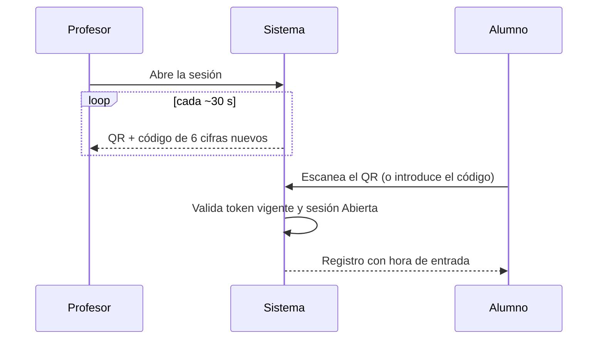

# Attendance mechanism v1

Se propone que el mecanismo v1 de asistencia sea un **QR rotativo**. Resuelve el punto pendiente "mecanismo concreto de asistencia" de [Session lifecycle](Session%20lifecycle.md) y se apoya en los estados de [Automatic attendance status system](Automatic%20attendance%20status%20system.md).

Es lo más simple que ya evita que sirvan fotos guardadas o QR de otros días.

## Cómo funciona

- El profesor muestra un QR que cambia cada ~30 s.
- El alumno lo escanea con su cuenta y queda registrado con la hora.
- En clases online, el QR se comparte en pantalla junto con un **código de 6 cifras** equivalente, que el alumno introduce a mano.
- Si alguien no puede registrarse, el profesor lo marca a mano con un motivo. Queda en el historial de auditoría.

## Reglas de negocio

- El QR solo se genera mientras la sesión está `Abierta`. Con la sesión `Programada`, `Cerrada` o `Cancelada` no se acepta registro.
- Cada QR y su código de 6 cifras caducan a los ~30 s y son equivalentes entre sí.
- El alumno debe estar autenticado y matriculado en el curso de la sesión.
- Un registro válido pasa al alumno de `Pendiente` a `Presente` o `Retraso`, según la hora de entrada respecto al inicio de la sesión.
- Se guarda la hora de entrada de cada registro.
- Marcado manual: el profesor puede registrar a un alumno que no pueda escanear. El motivo es obligatorio y queda en auditoría (quién, cuándo y por qué).
- Un QR de otra sesión o de otro día no es válido.

## Fuera de alcance (después)

- Señales antifraude.
- Comprobación aleatoria "¿sigues ahí?".

Por ello, v1 acredita la entrada, no la permanencia durante toda la clase (sección 11 del README).

## Pendiente

Queda pendiente definir:

- La caducidad exacta del QR y del código, y si hay margen de tolerancia.
- Si cada alumno puede registrarse una sola vez por sesión.
- El umbral que separa `Presente` de `Retraso`.
- Cómo se registra la salida en v1.
