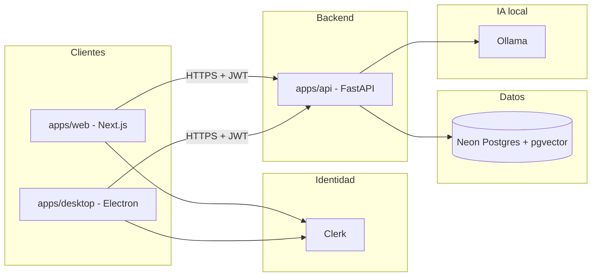

# Sugerencias para aTempo

Documento vivo con **propuestas de stack**, **ideas de producto**, **despliegue** y **estructura del repositorio**.

Orientado al bootcamp de AI engineering: prioriza lo **estándar en mercado**, lo **gratis suficiente para el estudio** y lo que **beneficia al aprendizaje** del equipo.

**Restricciones acordadas:** frontend **Next.js**, backend **Python**.

---

## Índice

- [Tabla resumen del stack](#tabla-resumen-del-stack)
- [Arquitectura y monorepo](#arquitectura-y-monorepo)
- [Despliegue e infraestructura](#despliegue-e-infraestructura)
- [Frontend (web)](#frontend-web)
- [Desktop (profesor)](#desktop-profesor)
- [Backend y tooling](#backend-y-tooling)
- [Datos](#datos)
- [Autenticación](#autenticación)
- [Inteligencia artificial (chatbot)](#inteligencia-artificial-chatbot)
- [Flujos de referencia](#flujos-de-referencia)
- [Pendiente de definir](#pendiente-de-definir)
- [Historial de cambios](#historial-de-cambios)

---

## Tabla resumen del stack

| Tecnología | Capa | Estado | Justificación breve |
| --- | --- | --- | --- |
| **Next.js** | Web | Acordado | Routing y layouts por rol; estándar React en SaaS. |
| **TypeScript** | Web | Recomendado | Tipado en front profesional. |
| **Tailwind CSS** | Web / UI | Recomendado | Muy usado con Next y shadcn. |
| **shadcn/ui** | Web / UI | Recomendado | Componentes reutilizables sin librería opaca. |
| **Electron** | Desktop | Recomendado | App de escritorio del profesor (constitución del producto). |
| **Python** | Backend | Acordado | API + RAG en un ecosistema; demanda en AI engineering. |
| **uv** | Tooling | Recomendado | Deps reproducibles (`uv sync`) en todo el equipo. |
| **FastAPI** | Backend | Recomendado | API moderna; OpenAPI; ya familiar en el bootcamp. |
| **Pydantic** | Backend | Recomendado | Validación y contratos de datos. |
| **SQLAlchemy** | Datos | Recomendado | ORM estándar en Python (no atado solo a Postgres). |
| **Alembic** | Datos | Recomendado | Migraciones versionadas del esquema. |
| **Uvicorn** | Backend | Recomendado | Servidor ASGI para ejecutar FastAPI. |
| **Make** (o **just**) | Tooling | Recomendado | Comandos únicos: `dev`, `migrate`, etc. |
| **PostgreSQL** | Datos | Recomendado | Relacional; asistencia, roles, auditoría. |
| **Neon** | Datos (cloud) | Recomendado | Postgres compartido gratis para el equipo. |
| **pgvector** | IA / datos | Recomendado | Vectores RAG en la misma BD (alt.: Chroma local). |
| **Clerk** | Auth | Recomendado | Login en clientes; JWT verificado en FastAPI. |
| **Ollama** | IA (local) | Recomendado | LLM gratis en desarrollo y demos. |
| **Vercel** | Deploy web | Recomendado | Hosting estándar para Next.js. |
| **Render** | Deploy API | Recomendado | FastAPI en cloud gratis (con limitaciones); Neon no hospeda Python. |

**Leyenda:** **Acordado** = restricción del proyecto · **Recomendado** = propuesta del grupo (revisable).

---

## Arquitectura y monorepo

### Visión general



- Los clientes **no** acceden a Postgres directamente.
- **Una API Python** sirve a web y escritorio del profesor.
- **Ollama** en local para el bootcamp; no asumir LLM en Vercel/Render.

### Estructura del repositorio (monorepo)

Un solo repositorio Git; varias aplicaciones en subcarpetas (patrón habitual con web + desktop + API):

```text
aTempo/
├── README.md
├── sugerencias.md
├── Makefile                    # atajos: web, api, desktop
├── apps/
│   ├── web/                    # Next.js — admin org + portal alumno
│   ├── desktop/                # Electron — app profesor
│   └── api/                    # FastAPI — negocio, auth, RAG
└── packages/                   # cuando haga falta
    ├── ui/                     # componentes compartidos web/desktop
    └── api-client/             # cliente HTTP tipado hacia FastAPI
```

| Ruta en deploy | Servicio |
| --- | --- |
| `apps/web` | Vercel |
| `apps/api` | Render (u otro PaaS) |
| `apps/desktop` | Build local / releases (no Vercel) |

**Alternativa más simple** (solo web + API al inicio): se pueden crear primero `apps/web` y `apps/api`, y añadir `apps/desktop` cuando empiece el módulo del profesor.

---

## Despliegue e infraestructura

### Vercel

**Qué es:** plataforma de hosting y builds para Next.js.

**Por qué proponerlo**

- **Mercado / estándar** para frontends Next.
- **Bootcamp / gratis:** plan Hobby suficiente para demos y proyecto de estudio.

**Rol en aTempo:** despliegue de `apps/web`.

**Limitación de equipo (Hobby):** no es un “team Vercel” con todos los alumnos como seats; lo habitual es **una cuenta que conecta el repo** y el resto colabora vía **GitHub**. Previews: invitaciones limitadas en free tier.

**No hospeda:** FastAPI persistente ni Ollama.

---

### Render (API Python)

**Qué es:** PaaS que ejecuta un servicio web desde Git (Dockerfile o runtime Python).

**Por qué proponerlo**

- **Neon no es hosting de backend:** solo Postgres.
- **Gratis** con tier free (servicio que puede **dormir** tras inactividad — aceptable para entregas académicas).

**Rol en aTempo:** URL pública de `apps/api` para integrar con Vercel.

**Alternativa:** API **solo en local** durante fases tempranas; front en Vercel con `API_URL` apuntando a localhost en desarrollo.

---

### Neon

**Qué es:** PostgreSQL gestionado en la nube.

**Por qué proponerlo**

- Postgres **compartido** para el equipo en free tier usable.
- Misma tecnología que en local/producción profesional.

**Rol en aTempo:** datos de negocio; opcionalmente **pgvector** para RAG.

**No sustituye:** Supabase completo (auth + API + realtime en uno).

---

## Frontend (web)

### Next.js

**Qué es:** framework React con App Router, SSR/SSG y convenciones de producción.

**Por qué proponerlo**

- **Mercado:** stack front muy extendido.
- **aTempo:** admin de organización y portal alumno (rutas y layouts por rol).
- **Acordado** con el bootcamp.

**Rol:** `apps/web`; consume FastAPI con JWT de Clerk.

---

### TypeScript

**Qué es:** JavaScript con tipos estáticos.

**Por qué proponerlo**

- Estándar en equipos front medianos/grandes.
- Menos errores al integrar API y formularios.

**Rol:** tipado en `apps/web` (y opcionalmente en `packages/`).

---

### Tailwind CSS

**Qué es:** estilos utility-first.

**Por qué proponerlo**

- Combinación habitual con Next y shadcn.
- Iteración rápida en proyecto con muchas pantallas.

**Rol:** UI consistente admin + alumno.

---

### shadcn/ui

**Qué es:** componentes React (en el repo) sobre Radix + Tailwind.

**Por qué proponerlo**

- Productividad: tablas, formularios, diálogos.
- Patrón muy usado en apps Next actuales.

**Rol:** UI principal de `apps/web`; parte reusable vía `packages/ui` hacia desktop si conviene.

---

## Desktop (profesor)

### Electron (`apps/desktop`)

**Qué es:** aplicación de escritorio con UI web (Chromium) + Node en el main process.

**Por qué proponerlo**

- **Producto:** la constitución prevé app de **escritorio del profesor** (sesiones, asistencia ágil, incidencias).
- **Mercado:** patrón conocido para “web skills + app instalada”.
- **Monorepo:** convive con `apps/web` y comparte API y posiblemente `packages/ui` / `packages/api-client`.

**Rol:** cliente del profesor; misma API y auth que la web.

**Alternativas descartadas por ahora:** Tauri (menos material en bootcamp), PWA sola (limitaciones offline/dispositivo según requisitos).

---

## Backend y tooling

### Python

**Qué es:** lenguaje del servidor API, migraciones, ingest RAG y reglas de negocio.

**Por qué proponerlo**

- Ecosistema **LLM / RAG / datos** en Python.
- **Acordado**; separación clara respecto a Next.js.

**Rol:** `apps/api` exclusivamente para lógica de servidor (no mezclar con Node salvo tooling).

---

### uv

**Qué es:** gestor de proyecto Python (venv, lockfile, instalación rápida).

**Por qué proponerlo**

- Estándar emergente para equipos (`uv sync` = mismas versiones).
- Reduce fricción “en mi máquina funciona”.

**Rol:** `apps/api/pyproject.toml` + lock; Make invoca uv.

**No confundir con Uvicorn** (servidor HTTP).

---

### FastAPI

**Qué es:** framework para APIs HTTP con OpenAPI automático.

**Por qué proponerlo**

- Muy usado en servicios y en proyectos que envuelven ML/LLM.
- Ya lo conocéis del bootcamp.

**Rol:** REST (asistencia, cursos, usuarios/roles), `/chat` RAG, validación JWT.

**Nota:** no es un “framework de IA”; es la capa HTTP donde también vive el chatbot.

---

### Pydantic

**Qué es:** validación de datos con modelos tipados en runtime.

**Por qué proponerlo**

- Estándar con FastAPI (request/response).
- Útil también fuera del framework (config, schemas de mensajes).

**Rol:** contratos de la API y payloads del chat.

---

### SQLAlchemy

**Qué es:** ORM y acceso SQL desde Python.

**Por qué proponerlo**

- ORM más extendido en APIs Python.
- Funciona con Postgres, SQLite local, etc.

**Rol:** modelos de dominio (cursos, sesiones, asistencia, auditoría).

---

### Alembic

**Qué es:** migraciones de esquema para SQLAlchemy.

**Por qué proponerlo**

- Práctica real de evolución de BD en equipo.
- Independiente de FastAPI; compatible con cualquier BD que use SQLAlchemy.

**Rol:** versionar tablas aplicables en Neon compartido.

---

### Uvicorn

**Qué es:** servidor ASGI que ejecuta la app FastAPI.

**Por qué proponerlo**

- Estándar de facto en desarrollo y muchas producciones FastAPI.

**Rol:** `make dev-api` → uvicorn con `--reload` en local.

---

### Make (o just)

**Qué es:** recetas de comandos en la raíz del monorepo.

**Por qué proponerlo**

- Un comando documentado para todos (`make dev-web`, `make dev-api`).
- Orquesta uv, uvicorn, npm/pnpm, etc.

**Rol:** DX del bootcamp; no sustituye a uv ni a Uvicorn.

---

## Datos

### PostgreSQL

**Qué es:** base de datos relacional.

**Por qué proponerlo**

- Estándar industrial para datos transaccionales.
- Encaja con relaciones org → cursos → sesiones → asistencia e informes.

**Rol:** fuente de verdad de negocio en Neon (y opcionalmente local).

---

### pgvector

**Qué es:** extensión de Postgres para búsqueda por similitud de vectores.

**Por qué proponerlo**

- Patrón “Postgres para todo” incluyendo embeddings.
- Un solo servicio (Neon) para datos + chunks RAG.

**Rol:** almacenar chunks de documentación y recuperación en `/chat`.

**Alternativa pedagógica:** **ChromaDB** en local si el módulo del curso lo prioriza; se puede migrar después a pgvector.

---

## Autenticación

### Clerk

**Qué es:** servicio de identidad (registro, login, OAuth) con SDK para React/Next.

**Por qué proponerlo**

- **Bootcamp:** evita implementar passwords/OAuth desde cero en Python.
- **Mercado:** patrón IdP + API que valida JWT.
- **Next.js + Electron:** mismo flujo de login en web y desktop (con integración adecuada en desktop).
- **Gratis:** plan Hobby generoso para proyecto de estudio.

**Rol:** identidad en clientes; **FastAPI** verifica JWT y aplica **RBAC** (admin org, profesor, alumno, admin aTempo).

**Comparación:** Supabase Auth lo conocéis, pero con BD en Neon son dos proveedores; Auth0 es estándar pero suele ser más “enterprise” en UX para Next.

**Aprendizaje clave:** la autorización vive en el **servidor**, no en el cliente.

---

## Inteligencia artificial (chatbot)

### Ollama

**Qué es:** runtime local de modelos LLM (HTTP).

**Por qué proponerlo**

- **Coste cero** en desarrollo y demos del bootcamp.
- Patrón habitual: probar local antes de APIs cloud en producción real.

**Rol:** generación de respuestas del chatbot; embeddings si el modelo elegido lo soporta.

**Limitación:** en deploy cloud (Render/Vercel) normalmente **no** corre Ollama; el chat “completo” se demo en local o se evoluciona después a API de pago.

---

### RAG (patrón)

**Qué es:** recuperar trozos relevantes de documentación y pasarlos al LLM como contexto.

**Por qué en aTempo:** chatbot transversal (constitución: RAG sobre docs y datos autorizados).

**Pasos:** ingest → chunk → embed → guardar (pgvector/Chroma) → pregunta → retrieve → prompt → Ollama.

**Regla de producto:** datos personales (p. ej. “¿cuántas faltas?”) deben obtenerse por **SQL** en FastAPI, no inventados por el LLM.

---

## Flujos de referencia

### Login y llamada a la API

1. Usuario inicia sesión en **web** o **desktop** vía **Clerk**.
2. Cliente obtiene JWT y llama a **FastAPI** (`Authorization: Bearer …`).
3. FastAPI valida token, resuelve rol, consulta **Neon**, responde JSON.

### Chat RAG (simplificado)

1. Usuario envía mensaje a `/chat` (autenticado).
2. FastAPI recupera chunks (pgvector) y, si aplica, datos del alumno por SQL.
3. FastAPI llama a **Ollama** con contexto y devuelve respuesta.

---

## Pendiente de definir

- Mecanismos concretos de **registro de asistencia** (QR, videollamada, etc.).
- Modelos concretos en **Ollama** (chat + embeddings).
- **Chroma vs pgvector** como primera implementación del vector store.
- Contenido inicial del **corpus RAG** (README, reglas, FAQ).
- Detalle de **integración Clerk en Electron**.
- Política de **owner** de cuentas Vercel/Render/Neon en el equipo.

---

## Historial de cambios

| Fecha | Cambio |
| --- | --- |
| 2026-11-05 | Versión inicial: Next.js, shadcn, PostgreSQL, Neon. |
| 2026-11-05 | Stack ampliado: uv, FastAPI, Alembic, Clerk, Ollama, pgvector. |
| 2026-11-05 | Monorepo `apps/web`, `apps/desktop`, `apps/api`; Vercel + Render; apartados con justificación. |
